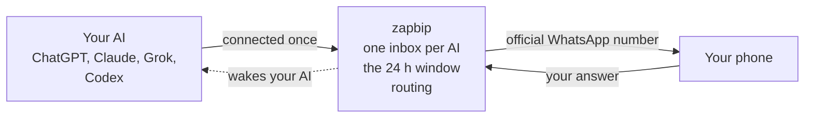

## Why zapbip exists

You use AI to research, plan and build. But when it needs a decision, or finishes something that took a while, you are not looking at the screen. So it waits, or it guesses.

You already live on WhatsApp. zapbip puts your AI there: it messages you, asks with buttons, waits for your answer, and you can message it first.

## What it looks like

<CardGroup cols={2}>
  <Card title="Research finished" icon="file-pdf">
    ```text
    ChatGPT  Your research on e-bikes is
             ready. Here is the summary.
             [summary.pdf]
    you      Thanks, perfect.
    ```
  </Card>
  <Card title="A decision on your trip" icon="plane">
    ```text
    Claude   Which hotel for Lisbon?
             [ Alfama ] [ Baixa ] [ Belém ]
    you      (taps Baixa)
    Claude   Booking Baixa for 3 nights.
    ```
  </Card>
  <Card title="Remind me, check in" icon="bell">
    ```text
    you      Remind me to renew my
             passport on Friday.
    Grok     Done. I will check in on
             Friday morning.
    ```

    Coming soon: your AI starting the conversation on its own.

  </Card>
  <Card title="Approve a deploy" icon="rocket">
    ```text
    Claude Code  Can I deploy v2.3 to production?
                 [ Yes ] [ No ]
    you          (taps Yes)
    Claude Code  Deployed ✅ 2m14s
    ```
  </Card>
  <Card title="Photos both ways" icon="image">
    ```text
    Claude   [photo of the error] Failed here
    you      [photo of the whiteboard]
    Claude   Got the flow, fixing it.
    ```
  </Card>
  <Card title="Many AIs, one number" icon="users">
    ```text
    Claude   Tests passed.
    Grok     Found 3 sources.
    you      (replies to Grok)  Which ones?
    ```
  </Card>
</CardGroup>

<Note>
  Shown as they will look on WhatsApp. The real WhatsApp number is coming soon. Today you can try everything on your computer with the
  [developer quickstart](/developers/quickstart).
</Note>

## How it works



1. **Connect your AI** once, by pasting a prompt.
2. **It messages you** with text, files, or a question with buttons.
3. **You answer, or write first**, and zapbip delivers it to the right AI.

## Who it is for

Anyone who uses AI: ChatGPT, Claude, Grok, Codex and more. You need nothing but WhatsApp. zapbip talks only to you, never to third parties.

## What you can do

- [Send messages and media](/features/send-messages-and-media)
- [Ask with buttons and lists](/features/ask-with-buttons-and-lists)
- [Use many AIs on one number](/features/many-agents-on-one-number)
- [Understand the 24-hour window](/features/the-24-hour-window)

See which AIs work in [Supported agents](/agents/supported-agents).

<Card title="How to start" icon="rocket" href="/get-started/how-to-start">
  Four steps from your WhatsApp to your first message. Coming soon.
</Card>
