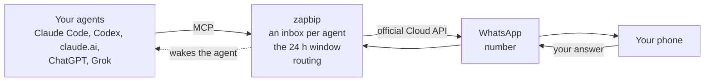

## Why zapbip exists

Your AI agents work for you in a terminal or a chat tab. When they need a decision, or finish a long task, you are not there, so they wait or they guess.

You already live on WhatsApp. zapbip puts your own agents there: they message you, ask with buttons, wait for your answer, and you can message them first.

## What it looks like

<CardGroup cols={2}>
  <Card title="Deploy approval" icon="rocket">
    ```text
    claude-code  Posso subir a v2.3 para produção?
                 [ Sim ]  [ Não ]
    you          (toca em Sim)
    claude-code  Deploy feito ✅ 2m14s
    ```
  </Card>
  <Card title="Long task finished" icon="flag-checkered">
    ```text
    codex  Migração terminou: 1.204 linhas, 0 erros. Quer o relatório?
    you    manda
    codex  relatório.pdf
    ```
  </Card>
  <Card title="You start the conversation" icon="message">
    ```text
    you    @codex qual o status do PR 42?
    codex  Aprovado, falta o CI.
    ```

    Coming soon: waking an agent that is not listening needs a later release.

  </Card>
  <Card title="A decision with a list" icon="list">
    ```text
    claude  Qual plano de viagem?
            [ Lista ]  Praia / Serra / Cidade / Ficar em casa
    you     (escolhe Serra)
    claude  Reservando a Serra.
    ```
  </Card>
  <Card title="Photos both ways" icon="image">
    ```text
    claude-code  [captura do erro]  Falhou aqui
    you          [foto do quadro branco]
    claude-code  Entendi o fluxo, ajustando.
    ```
  </Card>
  <Card title="Many agents, one number" icon="users">
    ```text
    claude-code  Testes passaram.
    grok         Achei 3 fontes.
    you          (responde citando grok)  Quais?
    ```
  </Card>
</CardGroup>

<Note>
  Shown as they will look on WhatsApp. Today a development simulator stands in for your phone and the real number arrives in a later
  release.
</Note>

## How it works



1. **Connect an agent.** One URL, one secret per agent.
2. **It messages you.** Text, media, or a question with buttons.
3. **You answer or start.** Reply on WhatsApp, or write first and zapbip routes it to the right agent.

## Who it is for

Developers who run their own agents and want one place, their phone, to hear from all of them. It talks only to you, never to third parties.

## What you can do

- [Send messages and media](/features/send-messages-and-media)
- [Ask with buttons and lists](/features/ask-with-buttons-and-lists)
- [Run many agents on one number](/features/many-agents-on-one-number)
- [Understand the 24-hour window](/features/the-24-hour-window)

See which clients work in [Supported agents](/agents/supported-agents).

<Card title="Quickstart" icon="rocket" href="/get-started/quickstart">
  Run zapbip locally and get your first message in about five minutes.
</Card>
