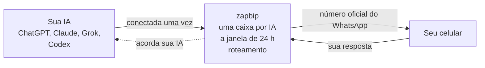

## Por que o zapbip existe

Você usa IA para pesquisar, planejar e construir. Mas quando ela precisa de uma decisão, ou termina algo que demorou, você não está olhando a tela. Aí ela espera, ou chuta.

Você já vive no WhatsApp. O zapbip coloca sua IA lá: ela te manda mensagem, pergunta com botões, espera sua resposta, e você também pode falar com ela primeiro.

## Como fica

<CardGroup cols={2}>
  <Card title="Pesquisa pronta" icon="file-pdf">
    ```text
    ChatGPT  Sua pesquisa sobre bikes
             elétricas ficou pronta.
             [resumo.pdf]
    você     Valeu, perfeito.
    ```
  </Card>
  <Card title="Uma decisão na viagem" icon="plane">
    ```text
    Claude   Qual hotel em Lisboa?
             [ Alfama ] [ Baixa ] [ Belém ]
    você     (toca em Baixa)
    Claude   Reservando Baixa por 3 noites.
    ```
  </Card>
  <Card title="Me lembra, dá um oi" icon="bell">
    ```text
    você     Me lembra de renovar o
             passaporte na sexta.
    Grok     Combinado. Te aviso na
             sexta de manhã.
    ```

    Em breve: sua IA puxando a conversa sozinha.

  </Card>
  <Card title="Aprovar um deploy" icon="rocket">
    ```text
    Claude Code  Posso subir a v2.3 para produção?
                 [ Sim ] [ Não ]
    você         (toca em Sim)
    Claude Code  Deploy feito ✅ 2m14s
    ```
  </Card>
  <Card title="Fotos nos dois sentidos" icon="image">
    ```text
    Claude   [foto do erro] Falhou aqui
    você     [foto do quadro branco]
    Claude   Entendi o fluxo, ajustando.
    ```
  </Card>
  <Card title="Várias IAs, um número" icon="users">
    ```text
    Claude   Testes passaram.
    Grok     Achei 3 fontes.
    você     (responde ao Grok)  Quais?
    ```
  </Card>
</CardGroup>

<Note>
  Mostrado como vai aparecer no WhatsApp. O número real do WhatsApp chega em breve. Hoje você testa tudo no seu computador com o [início
  rápido para desenvolvedores](/pt-br/developers/quickstart).
</Note>

## Como funciona



1. **Conecte sua IA** uma vez, colando um prompt.
2. **Ela te manda mensagem** com texto, arquivos ou uma pergunta com botões.
3. **Você responde, ou fala primeiro**, e o zapbip entrega para a IA certa.

## Para quem é

Para qualquer pessoa que usa IA: ChatGPT, Claude, Grok, Codex e outras. Você só precisa do WhatsApp. O zapbip fala só com você, nunca com terceiros.

## O que você pode fazer

- [Enviar mensagens e mídia](/pt-br/features/send-messages-and-media)
- [Perguntar com botões e listas](/pt-br/features/ask-with-buttons-and-lists)
- [Usar várias IAs em um número](/pt-br/features/many-agents-on-one-number)
- [Entender a janela de 24 horas](/pt-br/features/the-24-hour-window)

Veja quais IAs funcionam em [IAs compatíveis](/pt-br/agents/supported-agents).

<Card title="Como começar" icon="rocket" href="/pt-br/get-started/how-to-start">
  Quatro passos do seu WhatsApp até a primeira mensagem. Em breve.
</Card>
