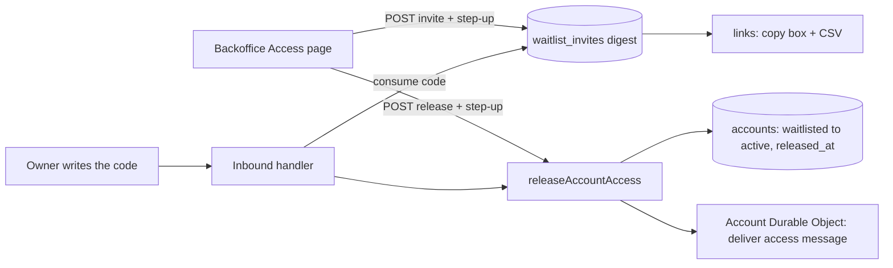

# Access release

**Status:** Building
**Tier:** 🔴 structural
**Owner approval:** approved 2026-11-13 (owner delegated)
**ADRs:** [0043](../../adr/0043-access-opens-in-batches-from-the-backoffice.md)
**Not changing:** the public site, the waitlist signup and its referral cap, the commands, the MCP server, the client app.

## Problem

The owner: "the referral is not for the waitlist but for when everything is live, because we will release access to some members. Implement releasing access for some members in the admin, and add some metrics so I understand usage, waitlist, etc. Releasing access must be in batch and simple." Today a WhatsApp account stays `waitlisted` forever and the email waitlist cannot be invited.

## Goals

1. Backoffice page Access (`/access`) with two lists, each with checkboxes, a select-all-matching option and filters (joined from, joined to, language).
2. WhatsApp accounts waiting: masked phone, joined, language. One action, Release access: moves the selected accounts to `active` through the core use case and sends each a WhatsApp message in its language; the result lists how many were released, were already active, were notified in session, were queued behind the notice template, and were not notified.
3. Email waitlist entries: one action, Invite: one single-use code per entry (digest stored, 30 days), the batch result shows the links in a copy box and a CSV download. The link opens WhatsApp on the start number with the code in the text.
4. The inbound handler redeems a code on the first message of a waitlisted account (new or existing) and opens it `active`; any other code or state changes nothing.
5. Both actions: POST, CSRF, step-up code, batch limit 50, one audit row per batch with counts, idempotent.
6. Metrics page section Access: waitlist total, per day (30-day sparkline) and by language; invited and used codes with 7 and 30 day windows; accounts by state; released accounts that connected an agent; agents connected; messages and answered questions per day with 7 and 30 day windows.
7. Migration `0012`, ADR 0043, runbook steps, copy in en_US and pt_BR.

## Non-goals

Sending email, scheduling a release, a per-person quota, re-showing an issued code, filtering by anything beyond date and language.

## Design

### Data flow

### Interfaces

`libs/core/src/accounts`: `releaseAccountAccess`, `findInviteCode`, `redeemAccessInvite`, `noticeAccessOpened`, ports `AccountDirectory.release` and `AccessInvites.consume`. `apps/api`: `AccountOwnerRpc.noticeAccessOpened`, D1 `waitlist_invites`, routes `GET /access`, `POST /access/release`, `POST /access/invite`, `POST /access/invites.csv`.

### Failure handling

Wrong step-up code: `401` flash, nothing changes. Nothing selected or over the limit: `422` flash. A delivery that fails is counted as not notified and the account stays released. A batch that fails midway leaves the accounts already released active; repeating it is a no-op for them.

## Open questions → answers

| Question | Options | Owner's answer | Date |
|----------|---------|----------------|------|
| Where does the referral count? | on the waitlist, or when access opens | when access opens; the cap stays as it is | 2026-11-13 |
| How is a batch selected without a script? | per-row boxes, plus "select all matching the filters" capped at the batch limit | decided by the developer, owner delegated | 2026-11-13 |

## Test strategy summary

Unit for the state transition, the code parser and the invite rules; integration for both batches, the first message with a code and the metrics; a Playwright walk of the batch release at 1440 and 375.
