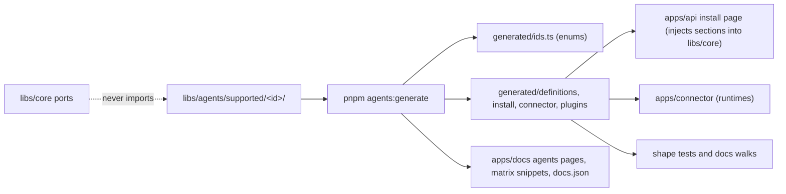

# Agent registry: one folder per supported agent

**Status:** Building
**Tier:** 🔴
**Owner approval:** owner order 2026-11-07; open questions owner delegated 2026-11-06 (recommended options taken)
**ADRs:** [0033](../../adr/0033-one-folder-per-supported-agent.md) (Accepted, this feature); builds on [0001](../../adr/0001-one-source-per-agent-surface.md), [0008](../../adr/0008-a-pure-core-behind-ports.md), [0019](../../adr/0019-outbound-wake-targets-pinned-providers-and-guarded-generic-hosts.md), [0020](../../adr/0020-one-install-link-per-connection-the-ai-reads-the-instructions.md), [0028](../../adr/0028-the-native-channel-plugin-is-the-first-rung-for-openclaw-and-hermes.md), [0030](../../adr/0030-the-docs-speak-to-any-ai-user-in-two-languages-and-the-switcher-picks-the-language.md), [0034](../../adr/0034-the-hermes-wheel-is-self-hosted-and-installed-by-a-pinned-hash.md)
**Not changing:** the content of the install page (`GET /i/:installCode`): every section, in both locales, with and without a standby, stays byte for byte the same; the content of every agent docs page in both languages: it moves, it is not rewritten. C0 pins this with goldens before any refactor (Plan, Step 4a). **The one intended change is order**, made in one commit (Plan, Step 13b) and nowhere else: (1) the install page sections go from the `InstallClient` enum order (claude-code, codex, cursor, gemini-cli, grok-bot, claude-ai, chatgpt, grok-web, hermes, openclaw) to wake rung, then name (claude-code, codex, cursor, gemini-cli, hermes, openclaw, claude-ai, grok-bot, chatgpt, grok-web); (2) the matrix rows swap Grok Bot and claude.ai (webhook rung: claude.ai, then Grok Bot) and are otherwise unchanged; (3) the `Agents` and `IAs` navigation lists go from today's hand order (claude-code, codex, claude-ai, chatgpt, cursor, grok-bot, grok-web, hermes, openclaw, gemini-cli, any-mcp-client) to the matrix order, with `supported-agents` first as today. The MCP tools, the `/pkg/` route bytes and headers, the hosted wheel and its pinned hashes (ADR 0034), the deploy preflight's refusals and messages (one operator-visible rename: the step label "refused at hermes wheel:" becomes "refused at plugin wheel:", because the step no longer names an agent), the wake ladder, the pinned wake providers (ADR 0019) and their stored `provider` values. The connector WebSocket protocol, and how `connect` wakes a session (isolation rules stay exactly as they are). The Hermes and OpenClaw packages and their published names. The developer harness surfaces (`.claude`, `.codex`, `.agents`, ADR 0001); they name Claude Code and Codex as the tools we build with, not as supported agents.
**Depends on:** `install-skills`, `docs-experience`, `deploy-readiness` and `hermes-wheel-hosting`, all merged on `main` at 6d32299. Step 0 starts from there.

## Problem

Owner order, 2026-11-07, verbatim: "if I need to add a new AI agent or remove one, how many files do I have to change? The answer should be at most one or two folders at most … so that dependency inversion becomes truly functional".

Today, knowledge of an agent is spread across four workspace packages. Exhaustive `Record<InstallClient, …>` tables force the edits. Hand-written lists in tests and walks silently skip an agent nobody remembered to add. Facts about one agent (its rung, its delay, its set_wake modes) sit in three different files. Core modules (`libs/core/src/install`) list the agents by name, so the core depends on the catalogue instead of the catalogue plugging into the core.

### Inventory (main at 6d32299, 2026-11-07)

Classes: **R** registration point, edited for every agent. **R!** forced by typecheck or a failing test. **R?** required but silent: forget it and nothing fails, the agent just goes unchecked. **M** mechanism, edited only when the agent brings a new mechanism. **P** plugin. **F** a test of a shared mechanism that uses one agent as its fixture. **I** illustrative mention: a brand name in prose or an example chat. Install-skills, docs-experience, deploy-readiness and hermes-wheel-hosting are all merged: there is one page shape (the four `AGENT_PAGE_HEADINGS`) and the parity tests read it.

| Path | Names | Class |
|---|---|---|
| `libs/types/src/enums.ts` | `InstallClient` (10), `DocsOnlyClient` (any-mcp-client), `WakeProvider` (GrokRoutine, ClaudeRoutine) | R! (Install, DocsOnly), M (WakeProvider) |
| `libs/types/src/constants.ts` | `CODEX_TOOL_TIMEOUT_SECONDS`, `CHATGPT_POLL_INTERVAL_MINUTES`, `OPENCLAW_PLUGIN_NPM_VERSION`, `ZAPBIP_HERMES_PLUGIN_VERSION`, `ZAPBIP_HERMES_WHEEL_SHA256`, `ZAPBIP_HERMES_REQUIREMENTS_SHA256` (`ZAPBIP_NPM_VERSION` and `PRODUCTION_PACKAGES_BUCKET` are shared, they stay) | R (per agent constant), P |
| `libs/types/src/hermes-wheel.ts` (+ test) | the hosted wheel and requirements file names, paths and patterns | P |
| `libs/types/src/connector.ts` | `ConnectorClient` (ClaudeCode, Codex), `CLAUDE_*` and `CODEX_*` constants | M |
| `libs/types/src/channel-plugin.ts` | `ChannelPluginProduct`, `CHANNEL_PLUGIN_PACKAGE_NAME` (no consumer in code) | P |
| `libs/core/src/install/install-products.ts` | `INSTALL_PRODUCTS: Record<InstallClient, …>` | R! |
| `libs/core/src/install/prompts/index.ts` | `INSTALL_SECTIONS: Record<InstallClient, …>` | R! |
| `libs/core/src/install/prompts/<client>.ts`, `<client>-copy.ts` (10 + 10) | one section and its copy per client | R (new files) |
| `libs/core/src/install/prompts/wake-notes.ts` | `WAKE_NOTES: Record<InstallClient, …>`, the Grok web special case | R! |
| `libs/core/src/install/prompts/connector-commands.ts` | `HERMES_INSTALL_COMMAND` (the pinned-hash wheel install, exported by `@zapbip/core`), `OPENCLAW_INSTALL_COMMAND` (not exported), `connectCommand({ client: InstallClient })` | P, M |
| `libs/core/src/install/snapshots/<client>.<en_US\|pt_BR>.md` (22, two of them `grok-web.standby`) | file snapshots, read by `snapshots.test.ts` | R (new files) |
| `libs/core/src/install/prompts/sections.test.ts` | `ALLOWED_WAKE_MODES: Record<InstallClient, …>` | R! |
| `libs/core/src/install/prompts/{chat-clients,editor-clients,install-copy,claude-code,codex}.test.ts`, `snapshots.test.ts`, `testing/fixtures.ts` | per-client cases | R (convention); breaks on removal |
| `libs/core/src/install/guide-parity.test.ts`, `tools/repository-shape/src/install-guides.test.ts` | `PLUGIN_PAGE_CLIENTS` (Hermes, OpenClaw) and the step-guide split | P |
| `libs/core/src/wake/wake-provider.ts`, `libs/core/src/wake/constants.ts`, `apps/api/src/adapters/wake/fetch-wake-transport.ts` | pinned provider rules and headers | M |
| `apps/connector/src/{session-lookup,wake-commands,wake-isolation,wake-runner,cli,connect}.ts` | `SESSION_FINDERS`, `CLIENT_BINARY_NAME`, `RESUME_ARGUMENT_BUILDERS`, `WAKE_ISOLATION_PREPARERS`, the Codex active-writer branch, the usage line | M |
| `apps/connector/test/{unit,integration,e2e}/{session-lookup,wake-commands,wake-isolation,cli,connect,wake-runner}*.test.ts`, `test/fixtures/bin/claude`, `test/support/fake-client-binary.ts` | per-runtime tests and fakes | M |
| `apps/api/src/routes/package.ts` (+ `test/integration/package-route.test.ts`) | serves the hosted Hermes wheel and requirements file from R2 under `/pkg/` | P |
| `apps/api/src/operations/deploy-preflight.ts`, `apps/api/scripts/{deploy,docs-preflight}.ts`, `apps/api/test/unit/{deploy-preflight,deploy-entry,docs-preflight-entry,openclaw-plugin-version}.test.ts`, `fake-deploy-shell.ts`, `test/e2e/{deploy-dry-run,global-setup}*.ts` | `OPENCLAW_PLUGIN_PACKAGE`, `publishedPackageSpecsOf`, the Hermes wheel preflight step and its four inputs (`hermesPluginVersion`, `hermesWheelSha256`, `hermesRequirementsSha256`, `openclawPluginVersion`) | P |
| `apps/api/test/unit/install-set-wake-modes.test.ts` | iterates `InstallClient` | none (already generic) |
| `apps/api/test/e2e/hermes-wheel.e2e.test.ts` | the wheel install end to end (`HERMES_INSTALL_COMMAND`) | P |
| `apps/api/test/e2e/claude-code.e2e.test.ts`, `claude-code-stack.ts`, `apps/docs/e2e/from-zero.spec.ts` | one agent as fixture; `MATRIX_CLIENTS` from both enums | F |
| `tools/repository-shape/src/docs-experience.ts` | `CLIENT_LISTEN_FACTS: Record<DocsAgentClient, …>`, `BACKGROUND_RUNNING_PAGES`, plus the shared vocabulary (`AGENT_PAGE_SECTIONS`, `AGENT_PAGE_HEADINGS`, `WAKE_RUNG_LABELS`, `LISTEN_STATEMENT_TOKENS`, `DOCS_GROUPS`, `twinPathOf`, `agentPagePathOf`) | R! |
| `tools/repository-shape/src/docs-experience.test.ts` | `DOCS_ONLY_PAGE_NAMES` (cursor, gemini-cli, any-mcp-client), `InstallClient.Cursor` as test data | R? (breaks on removal) |
| `tools/repository-shape/src/docs-conversations.test.ts` | `SPEAKER_LABELS`: a hand list of agent names; a new agent's chat bubbles are not checked until it is added | R? |
| `tools/repository-shape/src/docs-agent-install.test.ts` | Hermes and OpenClaw page strings, `HERMES_INSTALL_COMMAND`, a literal OpenClaw command | P |
| `tools/repository-shape/src/{plugin-versions,e2e-clients-scaffolding,hermes-wheel,runbooks}.test.ts` | plugin manifests, image digests, the wheel build script, runbook wording | P |
| `tools/repository-shape/src/install-e2e.test.ts`, `tools/install-e2e/claude-code.sh`, the `tools/install-e2e` line of `AGENTS.md`, its entry in `delivery-docs.test.ts` | owner-run Claude Code install; the folder is removed when the script moves into the agent folder | R (one agent) |
| `apps/docs/agents/<client>.mdx`, `apps/docs/pt-br/agents/<client>.mdx` (11 + 11) | the four-heading pages | R (new files) |
| `apps/docs/agents/supported-agents.mdx`, `apps/docs/pt-br/agents/supported-agents.mdx` | the eleven-row matrix, a table inside the page (there is no `snippets/agents/`; snippets are flat, with a `pt-br/` twin folder) | R! |
| `apps/docs/docs.json` | `Agents` and `IAs` page lists | R! |
| `apps/docs/e2e/agents-a.spec.ts`, `agents-b.spec.ts` | `CLIENTS_A`, `AGENT_CLIENTS`, `PLUGIN_COMMAND_OF` (imports `HERMES_INSTALL_COMMAND` through a deep relative path into `libs/core`), per-client tokens | R? |
| `apps/docs/developers/{local-connector,background-running}.mdx` (+ pt-br) | `--client claude-code\|codex`, Codex isolation prose | M |
| `apps/docs/{mcp-reference/set-wake,developers/webhook-wake,concepts/wake-ladder}.mdx` (+ pt-br) | provider table, rung examples ("7 s Claude Code") | M, I |
| `apps/docs/{index,get-started/how-to-start,features/*,help/troubleshooting}.mdx` (+ pt-br) | "ChatGPT, Claude, Grok…", chat bubbles named Claude and Grok | I |
| `scripts/e2e/clients/{hermes-client.ts,hermes/,openclaw-client.ts,openclaw/}` | Docker harness per plugin; `hermes/build-requirements.txt` is also read by the wheel build | P |
| `scripts/hermes-wheel/build.ts` (root script `hermes-wheel:build`) | builds the wheel; rewrites `ZAPBIP_HERMES_WHEEL_SHA256` and `ZAPBIP_HERMES_REQUIREMENTS_SHA256` inside `libs/types/src/constants.ts` | P |
| `apps/api/test/e2e/hermes-openclaw.e2e.test.ts`, root `package.json` (`test:e2e:clients`, `hermes-wheel:build`), `.github/workflows/verify.yml` (Python rows), `.agents/hooks/doctor.sh` (Python line) | plugin end to end and CI | P |
| `apps/hermes-plugin/`, `apps/openclaw-plugin/` | the plugin packages: Python platform adapter with `release/` artifacts, TypeScript channel plugin (ADR 0028) | P (package) |
| `docs/runbooks/{deploy,cloudflare-setup,mintlify-publish}.md` | wheel upload and plugin publish steps | I |
| `README.md`, `AGENTS.md`, `apps/connector/README.md`, `apps/api/README.md` | "Claude Code, Codex, any MCP client", "the hosted Hermes wheel" | I |

**To add one agent today** (an install client on a listen mechanism that already exists, the way Cursor and Gemini CLI were added): **16 files in 9 folders across 4 packages.** You create 6: section, copy, 2 snapshots, 2 pages. You edit 9 because a check forces you to: `enums.ts`, `install-products.ts`, `prompts/index.ts`, `wake-notes.ts`, `sections.test.ts`, `docs-experience.ts`, 2 matrices, `docs.json`. You edit 1 that nothing forces: `agents-a.spec.ts` or `agents-b.spec.ts`. By convention you also add one behaviour test and one name in `docs-conversations.test.ts` (18 files, the same 9 folders: `libs/types/src`, `libs/core/src/install`, `…/prompts`, `…/snapshots`, `tools/repository-shape/src`, `apps/docs`, `apps/docs/agents`, `apps/docs/pt-br/agents`, `apps/docs/e2e`).

**To remove one**: about 20 files in 9 folders. That includes 5 tests that name the member, for example `editor-clients.test.ts`, `docs-experience.test.ts` and `docs-conversations.test.ts` for Cursor.

**A plugin agent** (the Hermes or OpenClaw shape): the 16, plus about 22 more across 6 packages and CI (about 38 files in all), plus the plugin package. Hermes carries the most because of the hosted wheel: `package.ts` route, preflight step, build script, constants and hash rewrite, `hermes-wheel.ts`, 3 more tests. OpenClaw adds the preflight spec line, `OPENCLAW_PLUGIN_NPM_VERSION` and the version test.

**A connector-runtime agent** (the Claude Code or Codex shape): the 16, plus about 20 (about 36 in all) in `libs/types`, `apps/connector` (6 sources, 10 tests, a fake binary) and two developer pages in both languages.

Raw `git grep` on main (case-insensitive name or id, outside `docs/`, the harness folders, the lockfile, the docs prose pages and the two plugin packages) finds Cursor in 38 files, Claude Code in 54, Hermes in 49 and OpenClaw in 34, plus 2 docs pages each. Most Cursor and Claude Code hits are generic fixtures (an agent called `claude-code` in an API test, `cursor` as a database cursor, `api2.cursor.sh` as the Grok Bot wake host), not registry facts. The counts above (16, 18, about 20, about 38, about 36) are the files an agent actually forces or needs.

## Goals

1. **Add an agent = add one folder** `libs/agents/supported/<id>/`, then run `pnpm agents:generate`. Nothing outside that folder is edited by hand. A plugin agent also has its package folder `apps/<id>-plugin/`: **exactly two folders, and no third**. For that to be true, nothing a plugin needs lives anywhere else. The root scripts take the agent id (`pnpm plugin-wheel:build <id>`, `pnpm test:e2e:clients <id>`) and carry no agent name. `scripts/plugin-wheel/build.ts` iterates the `SelfHostedWheel` plugins. The plugin end-to-end iterates `AGENT_PLUGINS`. The `unit` matrix rows and the pip-install lines of `.github/workflows/verify.yml` are generated from `AGENT_PLUGINS`, between two `# NB ADR 0033` pointer lines that the generator owns. The runbooks name no agent and read per-agent facts from the registry output. **The claim excludes, by name:** a new pinned wake provider (Non-goals); a new language toolchain, that is the first plugin that is neither Node nor Python, which touches `doctor.sh` and the CI setup steps; the last connector runtime, which the connector application needs (removing it leaves the registry type empty and the application does not typecheck), and illustrative prose.
2. **Remove an agent = delete its folder(s)**, then run `pnpm agents:generate`. The generator deletes the agent's pages, its nav entries, its matrix row and its enum members. No other file names the agent, so nothing else breaks at typecheck.
3. **Dependency inversion.** `libs/core` and `libs/types` know no agent id. The core exposes ports (`InstallSection`, `InstallPageSection`). The agents plug into them. The composition roots (`apps/api`, `apps/connector`, the docs tooling) inject the registry.
4. **Enums without a second hand-edited place.** `AgentId`, `InstallClient`, `ConnectorClient` and `PluginAgent` are generated from the folders, in `libs/agents/src/generated/ids.ts`.
5. **Mintlify stays static.** The generated pages, matrix snippets and `docs.json` are committed. A shape test (gate `shape`, which runs on every class) fails whenever a generated file differs from what its folders produce.
6. **pt-BR quality preserved.** Page prose and install copy move byte for byte. Nothing is translated or templated. Proof: C0's goldens (the full install page in both locales, with and without standby, each matrix row and each nav entry) are committed first and stay green through every refactor commit; `apps/docs/agents/**` has an empty diff after the page move; only the order commit (Step 13b) changes the order golden.
7. **Guard tests.** Three fixtures, never discovered for real: `fixture-agent` (install and pages), `fixture-connector-agent` (a connector runtime with a fake binary) and `fixture-plugin-agent` (a plugin with a hosted artifact). Each, injected into the planner, shows up in the install page, the docs pages in both languages, the nav, the matrix and every parity check, and the changed outputs are exactly the generated set. Removing **each of the 11 real agents** removes it from all of them.

## Non-goals

- **New pinned wake providers, outside the one-or-two-folders claim.** A provider is a host allowlist entry and a stored value (`agent_wake.provider`), not an agent (ADR 0019). Adding one edits `libs/core/src/wake/wake-provider.ts`, `libs/core/src/wake/constants.ts` and `apps/api/src/adapters/wake/fetch-wake-transport.ts`, and stays a security decision with its own review. An agent folder that needs a new provider is two changes: the provider (reviewed), then the folder. An agent folder only uses existing providers through its install copy. Removing Grok Bot or claude.ai leaves `GrokRoutine` and `ClaudeRoutine` in place, so stored rows stay valid.
- **Generated prose.** No sentence of any page or install section is produced from data. Pages are hand-written fragments copied verbatim (ADR 0030 stands).
- **Illustrative mentions.** Brand names in the Overview, example chats, the wake-ladder examples and the set-wake platform note are not registry facts. `pnpm agents:mentions <id>` lists them for review when an agent is removed. They are not gated.
- **Toolchains.** `doctor.sh` and the `setup-python` steps of `verify.yml` exist because a Python plugin exists. A second Python plugin needs no edit, because its rows and pip lines are generated. Removing the last Python plugin, or adding the first plugin of another language, edits them by hand. `ci-workflow.test.ts` names them. Removing the last connector runtime is outside the claim too: the connector application indexes the registry by runtime and does not typecheck with none.
- **Version-token templating in pages** (`npx zapbip@0.1.0`). The pins and their tests stay as they are.
- **Changing the published `--client` values.** Removing a connector runtime takes effect for owners only when they upgrade `zapbip`. A pinned `npx zapbip@0.1.0` keeps the old runtime.

## Design

### Layout

```
libs/agents/                         @zapbip/agents
  supported/<id>/                    one folder per supported agent; folder name = id = docs slug = `--client` value
    definition.ts                    required: enumMember, docs names, page facts, listen facts
    page.en.mdx, page.pt-br.mdx      required: the whole page (frontmatter, imports, the four headings), hand-written
    install.ts, install-copy.ts      install facet: product name and description, section builder; owner copy keyed by OwnerLocale
    install.test.ts                  this agent's install behaviour (moved from libs/core)
    install.<owner locale>.md        generated: the rendered section (former snapshots), `install.en_US.md` and `install.pt_BR.md`; install.standby.<owner locale>.md when standby changes it
    connector.ts, connector.test.ts  connector facet (claude-code, codex): session finder, binary, resume and new-session arguments, isolation
    testing/                         connector facet: the fake binary its tests use
    plugin.ts                        plugin facet (hermes, openclaw): points at apps/<id>-plugin; its install command, version pins and hosted artifacts
    wheel.ts                         hermes only: the hosted wheel names, paths, patterns and pinned hashes (moved from libs/types)
    install-e2e.sh                   owner-run real install (claude-code)
  src/
    contract.ts                      AgentDefinition, AgentInstall, AgentConnectorRuntime, AgentPlugin, AgentFacet
    order.ts                         agentOrderOf: one order everywhere
    docs.ts                          AGENT_PAGE_HEADINGS, WAKE_RUNG_LABELS, LISTEN_STATEMENT_TOKENS, DOCS_GROUPS, page path helpers (moved from tools/repository-shape)
    checks/                          pure checks run by the shape tests and by the guard tests on planned output
    connector-support/               Node helpers shared by connector facets (temp wake directory, stale cleanup)
    generated/                       ids.ts, definitions.ts, install.ts, connector.ts, plugins.ts
    index.ts, install.ts, connector.ts, plugins.ts   facet entry points (package exports ".", "./install", "./connector", "./plugins", "./docs", "./generate")
  generate/                          discover, plan, render-*, write, cli (`pnpm agents:generate | agents:check | agents:new <id> | agents:mentions <id>`)
  testing/fixture-agent/             a complete install agent outside supported/, never discovered for real; also the template for agents:new
  testing/fixture-connector-agent/   a connector runtime with a fake binary and its connector paragraphs
  testing/fixture-plugin-agent/, testing/fixture-plugin-package/   a plugin with a hosted artifact and a release folder
  testing/golden/                    pins written before any refactor: install pages, matrix rows, nav entries; `order.json` is the only order-dependent pin
```

Generated outside the package: `apps/docs/agents/<id>.mdx`, `apps/docs/pt-br/agents/<id>.mdx`, `apps/docs/snippets/agents/matrix.mdx`, `apps/docs/snippets/pt-br/agents/matrix.mdx`, and the `Agents` and `IAs` page lists in `apps/docs/docs.json`. The matrix pages `apps/docs/agents/supported-agents.mdx` and the pt-br twin stay hand-written prose that imports the generated table snippet. The developer pages `local-connector` and `background-running` stay hand-written and byte-identical to main.

### Before and after

| Change | Before (files / folders) | After (hand-edited) | After (regenerated by one command) |
|---|---|---|---|
| Add an install agent on an existing mechanism | 16 / 9 (17 with its behaviour test) | 1 folder (6 files) | 9: `ids.ts`, `definitions.ts`, `install.ts`, 2 pages, 2 matrix snippets, `docs.json`, plus 2 rendered sections inside the folder |
| Remove it | ~20 / 9 | delete 1 folder | the same 9, and 2 pages deleted |
| Add a plugin agent | ~38 / ~18, plus the package (the third folder today is `.github/workflows`, with root `package.json` and `scripts/hermes-wheel`) | exactly 2 folders (agent + `apps/<id>-plugin/`, which holds its end-to-end client) | the 9 + `generated/plugins.ts` + the plugin rows and pip lines of `verify.yml` |
| Add a connector-runtime agent | ~30 / ~14 | 1 folder (with `connector.ts`) | the 9 + `generated/connector.ts` + 2 connector snippets |

### Data flow

1. **Discover (filesystem only).** `discoverAgents({ roots })` reads `libs/agents/supported/*/`. Each folder name must match `^[a-z][a-z0-9-]*$` and must not be `supported-agents`. Facets are read from which files are present (`AgentFacet`).
2. **Ids first.** `ids.ts` is rendered before any agent module is imported. That way an `install.ts` that imports `ConnectorClient` from `../../src/generated/ids` never sees a stale enum. `enumMember` comes from `definition.ts`, which imports only `@zapbip/types`, never the generated ids.
3. **Load.** The planner imports `definition.ts`, `install.ts` and `plugin.ts` (tsx in the CLI, vitest in the tests). `connector.ts` is never imported by the planner. Only its presence matters.
4. **Order.** `agentOrderOf` sorts by wake-ladder order (`Local`, `Webhook`, `Scheduled`, `Standby`, `Inbox`), then by the English `matrixName` in lower case. The same order is used in the nav, the matrix, the install page sections and the "Identify your product" list.
5. **Plan.** `planGeneratedFiles({ agents, readSource })` returns `{ writes, deletions, violations }`. Every TS, MDX and JSON write goes through Prettier with the repository config. `.md` renders are written as rendered (Prettier ignores them). Deletions only ever target outputs whose id is no longer discovered. A missing required facet is a violation, never a deletion.
6. **Write / check.** `agents:generate` applies the plan. `agents:check` exits 1 on any stale write, pending deletion or violation, and lists each path. `tools/repository-shape/src/agent-registry.test.ts` calls the same planner, so a hand edit to a generated page fails the `shape` gate in every class.
7. **Runtime injection.** `apps/api/src/routes/install-page.ts` calls `renderInstallPage({ …, sections: INSTALL_PAGE_SECTIONS })` from `@zapbip/agents/install`. `apps/connector` reads `CONNECTOR_RUNTIMES` from `@zapbip/agents/connector`. Deploy preflight and the plugin end-to-end read `AGENT_PLUGINS`. The docs walks and shape tests read `AGENT_DEFINITIONS`.



### Interfaces

```ts
// libs/agents/src/contract.ts
export type AgentDefinition = {
  enumMember: string;
  docs: {
    matrixName: Record<DocsLanguage, string>;
    linkName: Record<DocsLanguage, string>;
    pageFacts: Record<DocsLanguage, string[]>;
    speakerNames: string[];
  };
  listen: { rung: WakeRung; expectedDelaySeconds: number | null; setWakeModes: WakeMode[] };
};
export type AgentInstall = { productName: string; productDescription: string; render: InstallSection };
export type AgentConnectorRuntime = {
  binaryName: string;
  findNewestSessionId: (input: SessionLookupInput) => Promise<string | null>;
  resumeArguments: (input: { sessionId: string; isolationArguments: string[] }) => string[];
  newSessionArguments: ((input: { isolationArguments: string[] }) => string[]) | null;
  prepareIsolation: (input: WakeIsolationInput) => Promise<WakeIsolation>;
  isNewSessionFallback: (input: { stderrText: string }) => boolean;
};
export enum PluginRegistry { Npm = 'npm', SelfHostedWheel = 'self-hosted-wheel' }
export type HostedArtifact = { label: string; filename: string; path: string; contentType: string; expectedSha256: string; releaseFolder: string; embeddedInInstallCommand: boolean };
export type PluginWorkflow = { name: string; filter: string; pythonRequirements: string | null };
export type AgentPlugin = {
  packageFolder: string; packageName: string; registry: PluginRegistry; version: string;
  installCommand: string; hostedArtifacts: HostedArtifact[]; workflow: PluginWorkflow; buildRequirements: string | null; versionPins: { path: string; pattern: RegExp }[]; endToEndModule: string;
};
export enum AgentFacet {
  Definition = 'definition.ts', EnglishPage = 'page.en.mdx', PortuguesePage = 'page.pt-br.mdx',
  Install = 'install.ts', Connector = 'connector.ts', Plugin = 'plugin.ts', OwnerRunInstall = 'install-e2e.sh',
}
```

Changes to the core ports (`libs/core/src/install`):

- `formatSection({ product: { name, description }, wakeNote, steps })`. The core no longer looks up products or wake notes by client.
- `renderInstallPage({ agent, connectionLink, locale, standbyAgent, sections: InstallPageSection[] })`, where `InstallPageSection = { productName: string; render: InstallSection }`.
- `connectCommand({ connectionLink, client: ConnectorClient })`, the generated typed id, never a `string`. The connector CLI keeps its explicit branch for an unknown `--client`: it throws the usage line, and `cli.test.ts` pins it. There is no default client.
- Deleted: `install-products.ts`, `wake-notes.ts`, `prompts/index.ts`, `prompts/<client>*.ts`, `snapshots/`.

`libs/types` loses `InstallClient`, `DocsOnlyClient`, `ConnectorClient`, `ChannelPluginProduct`, `CHANNEL_PLUGIN_PACKAGE_NAME` and the per-agent constants. `HEARTBEAT_POLL_INTERVAL_MINUTES`, `CHANNEL_PLUGIN_SELF_TEST_TEXT` and the connector frame constants stay: the Python parity tests read them.

Enum members keep today's names through `enumMember` (`ChatGpt`, `OpenClaw`, `ClaudeAi`), so no consumer is renamed. Values stay the folder names (`chatgpt`, `openclaw`, `claude-ai`), so docs URLs and `--client` values do not change. The generated `.ts` files carry a single `// NB ADR 0033:` line, the one comment the conventions allow.

Dependency rule, enforced by `agent-registry.test.ts`:

- `libs/types` ← `libs/core` ← `libs/agents` ← {`apps/api`, `apps/connector`, `tools/repository-shape`, `apps/docs/e2e`}.
- `libs/core` and `libs/types` never import `@zapbip/agents`.
- An agent folder never imports another agent folder or `apps/*`.
- `definition.ts`, `install.ts`, `install-copy.ts` and `plugin.ts` import no `node:` module. Only `connector.ts` may.
- `apps/api/src` imports only `@zapbip/agents/install` and `@zapbip/agents/plugins`.

### How the plugins relate

`apps/hermes-plugin` (the self-hosted wheel `zapbip_platform`, ADR 0034) and `apps/openclaw-plugin` (npm `@zapbip/openclaw-plugin`) are real packages with their own toolchains (ADR 0028). They stay in `apps/`. Each agent folder's `plugin.ts` points at its package: package folder, name, registry, version, install command, hosted artifacts, the version pins `plugin-versions.test.ts` checks, and the module of its Docker end-to-end client. Each plugin's end-to-end client and Dockerfile move from `scripts/e2e/clients/` into `apps/<id>-plugin/e2e/`. The shared container helpers stay in `scripts/e2e/clients/`. `hermes-openclaw.e2e.test.ts` becomes `channel-plugins.e2e.test.ts`, which iterates `AGENT_PLUGINS` and imports each `endToEndModule`. A check fails when an `apps/*-plugin` package is claimed by no `plugin.ts`, or by more than one.

The Hermes plugin is not on PyPI (ADR 0034): its wheel and a hashed requirements file are hosted at `/pkg/` on the Worker, and its install command is `HERMES_INSTALL_COMMAND`. Everything about that moves into `supported/hermes/`: the command (out of `libs/core/src/install/prompts/connector-commands.ts`, so `@zapbip/core` stops exporting it), `wheel.ts` (out of `libs/types/src/hermes-wheel.ts` and its three constants in `constants.ts`), and `hostedArtifacts`. Three consumers become generic: `apps/api/src/routes/package.ts` serves `AGENT_PLUGINS.flatMap(hostedArtifacts)`, the deploy preflight's Hermes wheel step checks each hosted artifact (the refusal text is built from `label`, byte-identical), and `scripts/hermes-wheel/build.ts` rewrites the two hashes in `supported/hermes/wheel.ts`. `OPENCLAW_PLUGIN_NPM_VERSION` and `OPENCLAW_PLUGIN_PACKAGE` move into `supported/openclaw/plugin.ts`, and `publishedPackageSpecsOf` reads `AGENT_PLUGINS` for every `PluginRegistry.Npm` entry. `ZAPBIP_NPM_VERSION` is shared with `zapbip` itself and stays in `libs/types`.

Rules the plugin checks enforce, all in `libs/agents/src/checks/plugins.ts`:

1. Each hosted artifact exists in its `releaseFolder` and hashes to `expectedSha256`.
2. Every artifact with `embeddedInInstallCommand: true` has its hash inside the plugin's `installCommand`. For Hermes that is the requirements file; the wheel's hash lives inside that file, and a second check reads the file in `releaseFolder` and requires it.
3. The exact-filename allowlist of `routes/package.ts` is built from the artifacts' `filename`: exact match only, never a pattern over a directory.
4. `scripts/plugin-wheel/build.ts` keeps its exact-line match when it rewrites the hashes in `wheel.ts`, and the wheel test keeps its exact-line match.

`speakerNames` feeds `docs-conversations.test.ts`. Its `SPEAKER_LABELS` become the fixed labels (Owner, You, Dono, Você, Voce, Agent, Agente, zapbip) plus every agent's `speakerNames`: Claude Code and Claude; Gemini CLI and Gemini; Grok Bot and Grok; and the single names of the rest. A test asserts the derived set is a superset of today's list.

### Failure handling

| Case | Result |
|---|---|
| A generated file is edited by hand | `agent-registry.test.ts` fails in `shape`, naming the path and `run pnpm agents:generate` |
| A folder has no `page.pt-br.mdx`, or a heading is missing or out of order | violation `<id> page.pt-br.mdx: expected O que funciona \| Como ela escuta \| Configure do zero \| Confira se funciona`; the old page is left in place, never deleted |
| Two folders declare the same `enumMember`, or a folder name is invalid | violation naming both folders, or the folder and the rule |
| A page lacks one of its `pageFacts` | violation naming the agent, the language and the missing string |
| An agent folder imports another agent folder, or a Worker-side facet imports `node:` | boundary violation naming the file and the import |
| `docs.json` Agents group holds a page the generator does not own | violation naming the page |
| `--client` names no connector runtime | the connector throws the usage line (an explicit branch, no default); `cli.test.ts` pins it |
| A removed connector runtime is still requested by an old pinned `npx zapbip@<old>` | the old version keeps working; new versions refuse with the existing usage line, which lists `ConnectorClient` |
| A plugin's hosted artifact hashes differently from its pinned hash | the existing preflight refusal, unchanged, naming the artifact `label` |
| `verify.yml` plugin rows or pip lines differ from `AGENT_PLUGINS` | `agent-registry.test.ts::every generated file is fresh` fails naming the workflow |
| An install command lacks an embedded artifact's hash | the plugin check fails naming the plugin and the artifact `label` |
| Merge conflict in a generated path | never merged by hand: take either side, run `pnpm agents:generate`, commit `chore(agents): regenerate` |

### Rollback

Revert the merge commit. No data, schema or stored value changes. The content of the install page and the docs pages is byte-identical before and after (the goldens, proved in the test plan), so reverting changes nothing an owner sees except the order named under Not changing, which goes back to the hand order. Reverting only Step 13b restores the old order alone.

## Risks

1. **Mintlify needs static MDX.** Pages are generated and committed. A symlink from `apps/docs` into `libs/agents` was rejected because the hosted build cannot be proved to follow it. The matrix is a snippet import; spike S1 proves `mint@4.2.1207 dev` renders a table from an imported MDX snippet in both languages. If S1 fails, the generator writes the whole matrix page from two hand-written fragments (intro and outro) with the table between them.
2. **Worker bundle size.** The Worker imports only the install facet, which is the same copy it bundles today. Page fragments are never imported by TypeScript. Budget: the `wrangler deploy --dry-run --outdir` output is within +1% of the S4 baseline, and contains none of the page headings.
3. **pt-BR quality.** Moves only. The tester diffs the 22 pages and the 22 rendered sections against `main` and expects zero bytes changed.
4. **Prettier and JSON stability.** Spike S2 proves `prettier(JSON.stringify(JSON.parse(docs.json), null, 2))` equals the committed file. If it does not, the first generation commit normalizes it, alone.
5. **The connector refactor touches security code** (Codex isolation). It moves with `git mv`, its tests move unchanged, and the security reviewer diffs it with `-M`.
6. **The wheel hash rewrite.** The build script rewrites two constants in `wheel.ts`; the shape test for the script moves with it and keeps the exact-line match. The wheel hosted in R2 is unchanged, so no re-upload is needed.
7. **Lane collisions on generated files.** These are rerun, never merged by hand (Failure handling).

## Open questions → answers

| Question | Options | Owner's answer | Date |
|---|---|---|---|
| Where do the folders live? | `libs/agents/<id>/` · `libs/agents/supported/<id>/` | recommended: `supported/`, so the package's `src/`, `generate/` and `testing/` can never be mistaken for agents (owner delegated 2026-11-06) | 2026-11-07 |
| Generated files committed? | committed with a staleness test · built in CI only | recommended: committed; Mintlify reads the repository and GitHub Actions does not run here, ADR 0005 (owner delegated 2026-11-06) | 2026-11-07 |
| Enum member names | derived from the folder (`Chatgpt`, `Openclaw`) · `enumMember` in the definition | recommended: `enumMember`, so nothing is renamed (owner delegated 2026-11-06) | 2026-11-07 |
| One order for nav, matrix and install page | today's hand order with an `order` number per folder · rung then name | recommended: rung then name; no numbers to coordinate between folders; one reviewed reorder commit (owner delegated 2026-11-06) | 2026-11-07 |
| Move the connector runtimes in this feature? | yes (lane L5a) · later | recommended: yes; otherwise removing Codex still edits `apps/connector` (owner delegated 2026-11-06) | 2026-11-07 |
| Connector prose on the developer pages | hand-written · a generated snippet from each runtime's `connector.<lang>.mdx` | recommended: snippet; the paragraphs move, they are not rewritten (owner delegated 2026-11-06) | 2026-11-07 |
| Plugin build, root scripts and CI rows | per-agent root scripts and workflow rows · scripts take the id, iterate `SelfHostedWheel` plugins, workflow rows generated | recommended: generic and generated, so a plugin agent is exactly two folders (owner delegated 2026-11-06) | 2026-11-07 |
| Hash checks | pattern allowlists · `releaseFolder` per artifact, the hash embedded in the install command, exact filenames and exact-line matches kept | recommended: the latter (owner delegated 2026-11-06) | 2026-11-07 |
| Speaker labels | a hand list · an explicit `speakerNames` field with a superset test | recommended: the field (owner delegated 2026-11-06) | 2026-11-07 |
| Order change | a per-agent order number · rung then name in one commit, goldens pinned first | recommended: rung then name, one commit (owner delegated 2026-11-06) | 2026-11-07 |
| Scaffold command `agents:new <id>` | yes, copying the fixture · no | recommended: yes (owner delegated 2026-11-06) | 2026-11-07 |

## Test strategy summary

- **Generator unit (`libs/agents/generate/*.test.ts`):** discovery, order, enum and registry rendering, nav rewrite, matrix per language (delay labels `7 seconds` / `7 segundos`, `1 hour` / `1 hora`, `Not measured` / `Não medido`), copying and validating pages, deletions, violations, idempotence.
- **Guard (`tools/repository-shape/src/agent-registry.test.ts`, gate `shape`):**
  - a fixture agent appears everywhere and the changed outputs are exactly the generated set;
  - every input read for the fixture is inside its folder;
  - removing any real agent removes it everywhere;
  - no file outside an agent folder names an agent's enum member;
  - the dependency rule holds;
  - every generated file is fresh.
- **Moved behaviour:**
  - `/pkg/` bytes, headers and 404s (`package-route.test.ts`), the preflight refusals and the wheel install end to end (`hermes-wheel.e2e.test.ts`) pass with only import changes;
  - install sections byte-identical to the goldens committed in C0 (full page, both locales, with and without standby);
  - pages byte-identical;
  - the parity and set_wake checks iterate the registry;
  - the connector unit tests are moved, not modified.
- **Walks:** one generic `apps/docs/e2e/agents.spec.ts` over `AGENT_DEFINITIONS` in both languages and both widths; Playwright MCP on `mint dev` and on the install page.
- **Owner-run in a scratch worktree:** copy the fixture into `supported/`, generate, `pnpm verify all` green, `git status` shows only the folder and the generated set; delete it, generate, `git status` clean.
