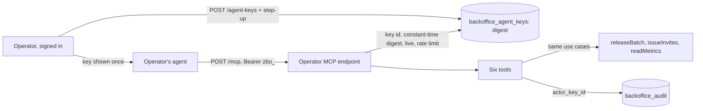

# Agentic backoffice

**Status:** Building
**Tier:** 🔴 structural
**Owner approval:** approved 2026-11-13 (owner delegated)
**ADRs:** [0046](../../adr/0046-an-operator-agent-runs-the-backoffice-through-mcp-with-a-scoped-key.md)
**Not changing:** the human sign-in, the step-up of the registry forms, the numbers pages, the product MCP server, the public site, the client app.

## Problem

The owner, 2026-11-13: "absolutely the whole experience must be agentic, everything, so that an agent can do everything on behalf of a human". The backoffice answers only to a person with a password, an authenticator and a cookie, so an operator's agent cannot read the metrics or open access.

## Goals

1. An Agent keys page in the backoffice: create a key (label, optional lifetime, default 90 days) behind CSRF and a step-up code, shown once and stored as a digest; list label, created, last used and expiry; revoke. Audit rows for create and revoke.
2. A `zbo_` key format with high entropy and a gitleaks rule and probe, so a leaked key is detectable.
3. An MCP endpoint `POST /mcp` on the backoffice host with a Bearer operator key and six tools: `metrics_summary`, `list_waitlist`, `list_waiting_accounts`, `release_access`, `invite_waitlist`, `list_audit`.
4. The writing tools call the same use cases as the Access page, take the same batch limit, require `confirm: true`, return counts (and the invite links to the issuing key) and write an audit row tagged with the key id.
5. A rate limit per key; revoked or expired keys refused; no cookies, no CORS; the product and operator keys never open each other's surface.
6. Runbook "Let an agent operate the backoffice", copy in en_US and pt_BR.

## Non-goals

Deleting accounts, connecting numbers and replacing credentials stay human-only. No second operator, no per-tool scopes, no OAuth, no key re-display.

## Design

### Data flow

### Interfaces

`apps/api/src/backoffice/operator-mcp/`: `operator-key` (create, parse, digest, liveness, lifetime), `operator-key-store` and `operator-key-auth` (D1 rows, constant-time check), `agent-keys-routes` and `agent-keys-page` (the page), `operator-mcp-routes`, `operator-mcp-server`, `operator-tools` (the tools), `operator-audit` (the agent audit writer). Routes `GET|POST /agent-keys`, `POST /agent-keys/revoke`, `POST /mcp`. Migration `0014`.

### Failure handling

Wrong step-up code: `401` flash, no key. Invalid label or lifetime: `422` flash. Revoking an unknown or already revoked key: `404`. At the endpoint: any bad key `401` with one body; a limited key `429` with `Retry-After`; a missing `confirm` or an oversized batch is a tool error that changes and audits nothing; a failed batch writes a `failed` audit row, as on the page.

## Open questions → answers

| Question | Options | Owner's answer | Date |
|----------|---------|----------------|------|
| Does revoking need a step-up code? | yes, like every registry change; no, so a leaked key is cut off fast | no, session and CSRF only (decided by the developer, owner delegated) | 2026-11-13 |
| May a key never expire? | optional expiry or always expiring | always expires, default 90 days, at most 365 (decided by the developer, owner delegated) | 2026-11-13 |
| What is a waitlist entry id? | an opaque id, the email | the email, the table's identity (decided by the developer, owner delegated) | 2026-11-13 |

## Test strategy summary

Unit for the key format, digest, liveness, lifetime and the gitleaks rule; integration for the page (CSRF, step-up, shown once, audit, logs) and the endpoint (every refusal, each tool, `confirm`, batch limit, audit tagging, rate limit, cross-surface refusals); a Playwright walk at 1440 and 375 that creates a key, calls the endpoint with it, revokes it and calls again.
