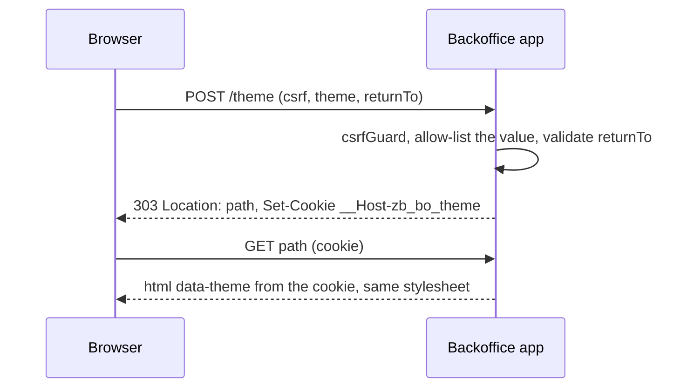

# Backoffice switchers

**Status:** Building
**Tier:** 🟡
**Owner approval:** owner delegated 2026-11-11
**ADRs:** none; no decision here adds an interface or a dependency, and the backoffice CSP does not change
**Not changing:** the Content-Security-Policy, the routes of every page, the sign-in and step-up flows, the CSRF guard, the session cookie, the copy of any existing key, the MCP host, `GET /start` and its hashed style, the docs

## Problem

The owner's order, 2026-11-11: "implementa lang switcher e theme switcher com icones", and "não faça tantos gates e verificações". The backoffice header already has a text-only language switch (`components/locale-switch.tsx`, `POST /locale`). It has no theme control: the stylesheet follows `prefers-color-scheme` and nothing else. The owner wants both controls, with icons, on every page that has the header.

## Goals

- Header, signed in and on the sign-in page: a language switcher (pt-BR, en) and a theme switcher (light, dark, system), each with inline SVG icons and an accessible label.
- No client script. The preference is a cookie set by a small form `POST` that answers `303` back to the page (POST/redirect/GET).
- The server renders the chosen locale and writes `data-theme="light|dark|system"` on `<html>`. `system` follows `prefers-color-scheme`; `light` and `dark` override it.
- Same "Signal" language as [ui-polish](../ui-polish/spec.md): tokens in the one stylesheet, no raw colour outside `:root`, AA in both themes.

## Non-goals

- A script, a toggle that works without a round trip, a per-account or stored-in-D1 preference, more locales or themes, a language or theme control on the MCP host.
- Changing the locale resolution order (cookie, then `Accept-Language`, then `DEFAULT_LOCALE`).

## Design

### Data flow

`requestContext` resolves `locale` (unchanged) and a new `theme` from the cookie; `PageContext`, `Layout` and the nine views thread `theme` the way they thread `locale`. `Layout` writes `<html lang data-theme>`.

### Interfaces

- `BackofficeTheme` enum: `Light = 'light'`, `Dark = 'dark'`, `System = 'system'`, in `apps/api/src/backoffice/backoffice-theme.ts` with `resolveTheme({ cookieValue })`: an allow-listed cookie value, otherwise `System`. The `System` fallback is a named, intended state (no preference stored), not a masked absence, and uses a branch, not `??`.
- `BackofficePath.Theme = '/theme'` beside `BackofficePath.Locale`; both are in `FORM_PATHS`, so `csrfGuard` covers them.
- One helper, `setPreferenceCookie({ context, name, value })`, shared by `/locale` and `/theme`; `/locale` moves onto it.
- `returnTargetOf({ returnTo })` in `apps/api/src/backoffice/return-target.ts` replaces the inline allow-list of `locale-routes.ts`.
- Cookie names: `__Host-zb_bo_locale` (existing) and `__Host-zb_bo_theme` (new), in `backoffice-constants.ts`.
- Components: `components/theme-switch.tsx` (three buttons: sun, moon, monitor), `components/locale-switch.tsx` (a globe icon on the group, the existing two buttons), `components/icons.tsx` (inline SVG as function components). Labels come from `backoffice-copy.ts` in pt_BR and en_US: `ThemeLabel`, `ThemeLight`, `ThemeDark`, `ThemeSystem`.
- Both switchers are forms with `aria-label`, buttons with `aria-pressed`, and, for the theme buttons, an `aria-label` per button (icon only). SVGs are `aria-hidden="true"` and `focusable="false"`.

### Icons and the CSP

`style-src 'self'` forbids `style=` attributes and `img-src 'self'` forbids data URIs, so the icons are inline `<svg>` elements drawn with attributes (`viewBox`, `fill="none"`, `stroke="currentColor"`) and sized by a class in the stylesheet. An inline `<svg>` element is markup, not a resource, so the CSP is untouched.

### Stylesheet

The tokens stay in `:root` blocks. A dark palette must now apply in two cases, so it appears twice and the two copies are pinned equal by a shape test (CSS cannot share a block between a media query and an attribute selector without script):

1. light `:root` (unchanged);
2. `@media (prefers-color-scheme: dark) { :root:not([data-theme='light']) { …dark tokens… } }`;
3. `:root[data-theme='dark'] { …the same dark tokens… }`.

`color-scheme` is `light` for `light`, `dark` for `dark`, `light dark` for `system`, so native controls follow. Switcher styles reuse `.locale-switch` (segmented pill), extended to the theme group; the icon buttons keep the 44 px tap size; the header already wraps at 375.

### Security

- **Cookie.** `__Host-` prefix, `Secure`, `HttpOnly`, `SameSite=Lax`, `Path=/`, `Max-Age` one year. `Lax` replaces today's `Strict` on the locale cookie: a `Strict` cookie is not sent on a top-level navigation from another site (a link in an email or a chat), so the first page would render in the wrong language. Nothing is gained from `Strict` here, since the cookie holds no secret and the write is behind the CSRF guard. A stale `SameSite=Strict` locale cookie written before this change lingers until the owner's next switch; that is acceptable, because it still carries a valid value and is only sent less often.
- **Allow-listed values.** The `POST` accepts only `Object.values(OwnerLocale)` or `Object.values(BackofficeTheme)`; anything else sets no cookie. On read, an unknown cookie value is ignored. `data-theme` and `lang` are rendered from enum members, never from the cookie string, so nothing is reflected unchecked.
- **Redirect.** `returnTo` is accepted only when it is a same-origin path: it starts with exactly one `/`, contains no `\`, no control character and no scheme, parses against the backoffice origin to the same origin, and its path is a backoffice page (`/`, `/sign-in`, `/numbers`, `/numbers/…`, `/metrics`, `/audit`). The redirect carries the path only (a filter query is dropped; the owner accepts the reset). Anything else redirects to `/`. No open redirect.
- **State change.** A switch is a `POST` behind `csrfGuard` (the `Origin` equals `BACKOFFICE_ORIGIN` and the form token is valid). A preference never changes on a `GET`, so a prefetch or an image tag cannot flip it.
- **CSP.** Unchanged, character for character (`backoffice-headers` pins it). No script, no `style=`, no new origin.

### The public `/start` page: no switchers

Decision: no. Reasons:

- Its no-number page answers with its own `style-src 'sha256-…'` (`start-link-style.ts`). Any change to that stylesheet changes the hash, the constant and its pin tests, and a mistake turns the page unstyled on the one page that must never fail.
- It is anonymous, on the MCP host, in a different origin from the `__Host-` cookies of the backoffice host: a preference could not be shared, and a new cookie there would be a new surface on a public route.
- It already does both jobs: the language follows `lang` and `Accept-Language`, and the theme follows `prefers-color-scheme` in its own style block. It is a rare, transient fallback (no active number), not a place to stay.

### Failure handling

| Case | Result |
|------|--------|
| Unknown `locale` or `theme` value | no cookie set, `303` to the validated target |
| Missing or foreign `returnTo` (`//evil.test`, `https://evil.test`, `/\evil.test`, `javascript:`) | `303` to `/` |
| Missing or wrong CSRF token or `Origin` | `403`, as for every form |
| Cookie absent or unknown | `System` theme; locale as today |

## Open questions → answers

| Question | Options | Owner's answer | Date |
|----------|---------|----------------|------|
| GET link or form POST | GET link · POST form | POST form behind `csrfGuard`, like the existing `/locale` (owner delegated 2026-11-11) | 2026-11-11 |
| Theme states | light and dark · plus system | light, dark, system (the owner's order) | 2026-11-11 |
| Cookie `SameSite` | Strict · Lax | Lax (owner delegated 2026-11-11) | 2026-11-11 |
| Dark tokens twice | duplicate with a parity test · `light-dark()` rewrite of every token | duplicate with a parity test, the smaller change (owner delegated 2026-11-11) | 2026-11-11 |
| `/start` no-number page | add switchers · leave it | leave it (owner delegated 2026-11-11) | 2026-11-11 |
| ADR | write one · none | none; no interface, dependency or CSP change (owner delegated 2026-11-11) | 2026-11-11 |

## Test strategy summary

One pass, no gates beyond the shape suite. Unit: `resolveLocale`, `resolveTheme`, `returnTargetOf`, the copy parity, the layout attributes and the switcher markup, the stylesheet rules (token blocks, dark parity, contrast of the forced-dark block). Integration: both cookies and the `303` through the real app, including every redirect attack. Browser: one Playwright MCP walk of both switchers at 1280 and 375, light and dark, sign-in and a signed-in page, with zero console errors and zero CSP violations. Details in [test-plan.md](test-plan.md).
