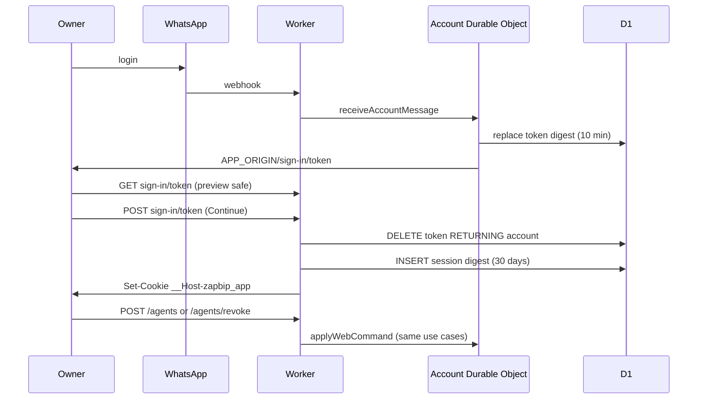

# Customer web app

**Status:** Building
**Tier:** 🔴 structural
**Owner approval:** approved 2026-11-13 (owner delegated)
**ADRs:** [0042](../../adr/0042-the-customer-web-app-signs-in-with-a-one-time-link-sent-over-whatsapp.md)
**Not changing:** the commands and their replies, the MCP server, the install page, the backoffice and the public site, the account states and the Durable Object storage.

## Problem

The owner asked "where is the clients app? keep it minimum" and "make all decisions". Today customers manage everything over WhatsApp. [accounts-and-keys](../accounts-and-keys/spec.md) listed "no OTP and no web dashboard" as a non-goal; this feature supersedes that one non-goal for a single minimal page. The phone stays the only identity.

## Goals

1. `app.zapbip.com` and `app-staging.zapbip.com` serve the app from the API Worker through host dispatch; both custom-domain routes are in `wrangler.jsonc`.
2. Signed out: one button, "Sign in with WhatsApp" / "Entrar com WhatsApp", that opens `wa.me/<start number>?text=login` (`entrar` in Portuguese). With no active start number the page answers `503`.
3. The `login` / `entrar` command replies with `<APP_ORIGIN>/sign-in/<token>`; works for `waitlisted` and `active`, refused for `suspended` and `deleting` like every command.
4. `GET /sign-in/<token>` never consumes; `POST` consumes once and sets the session cookie. Expired, used or unknown tokens show "This link expired. Send login again."
5. Waitlisted account: "You're on the waitlist" and Sign out.
6. Active account: the agents list (name, client, created), Revoke per agent behind a confirmation step, "Connect an agent" through the same create use case as `new agent`, showing the install prompt once, the plan line "Free · early access", a link to the delete-account docs page, Sign out.
7. English at `/`, Portuguese at `/pt-br`; after sign-in the account's language decides.
8. Light and dark following the system, 375 px with a 16 px gutter, no script.
9. Expired tokens and sessions are pruned by the scheduled tick.
10. Docs page `features/web-app` in both languages and the `login` command in the commands page.

## Non-goals

Billing, usage meters, bringing your own number (never implied), editing agents, deleting the account on the web, a JS framework, a language or theme switcher beyond two links.

## Design

### Data flow

### Interfaces

| Method and path | Effect |
|---|---|
| `GET /`, `/pt-br` | signed out: sign-in page; signed in: the app page |
| `GET /sign-in/<token>` | Continue page, or the expired page (`410`) |
| `POST /sign-in/<token>` | consume, session, `303` to the account's home; expired `410`; rate limited `429` |
| `POST /sign-out` | delete the session, `303` to `/` |
| `POST /agents` | create an agent, `200` page with the install prompt once |
| `POST /agents/revoke` | without `confirm`: confirmation page; with `confirm`: revoke, `303` home with a notice |
| `GET /app.css`, `/favicon.svg` | assets |

Every POST needs a same-origin `Origin` and a CSRF token derived from the session (from the link token on the Continue page). The same paths exist under `/pt-br`.

### Data

Migration `0011`: `client_app_sign_in_tokens (token_digest PK, account_id, created_at, expires_at)` with one live token per account, `client_app_sessions (session_digest PK, account_id, created_at, expires_at)`. Account removal deletes both tables' rows for the account.

### Failure handling

| Case | Result |
|---|---|
| unknown, expired or used link | `410` page, nothing created |
| no start number | `503` page |
| session of a `suspended` or `deleting` or deleted account | treated as signed out |
| name invalid, taken, reserved or limit reached | the page again with the reason, nothing created |
| missing or wrong Origin or CSRF | `403` |
| sign-in rate limited | `429` with `Retry-After` |
| WhatsApp unreachable after `login` | the existing send-failed behaviour; the token stays valid until it expires |

## Open questions → answers

| Question | Options | Owner's answer | Date |
|----------|---------|----------------|------|
| Which account states may sign in | all / waitlisted and active | `waitlisted` and `active`; the brief's "disabled/closed" are the code's `suspended`/`deleting` | 2026-11-13 |
| Sign-in method | email, code, link | one-time link over WhatsApp (ADR 0042) | 2026-11-13 |
