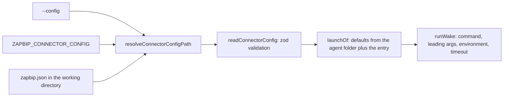

# Connector runtime configured by one zapbip.json file

**Status:** Shipped 2026-11-14
**Tier:** 🟡 medium
**Owner approval:** the owner asked on 2026-11-14 that the runtime the local connector launches be changeable, for someone who runs `ccs` instead of `claude`, or who needs other arguments, with one generic JSON file that every AI reads the same way
**ADRs:** [0066](../../adr/0066-the-connector-runtime-is-set-by-one-zapbip-json-file.md), extending [0064](../../adr/0064-a-wake-provider-and-a-channel-protocol-belong-to-the-agent-folder.md)
**Not changing:** the arguments the connector builds for the session (resume, safety, isolation, the prompt on standard input), the agent folders' defaults, the wake queue and the log events

## Problem

`connect` launches the binary named in each agent folder, `claude` or `codex`, with the arguments that folder builds. An owner who starts Claude Code through `ccs`, or who needs another flag, cannot change that without editing code.

## Goals

- One JSON file, `zapbip.json`, with the same shape for every AI: per connector client, the command, the leading arguments, extra environment variables and the wake timeout.
- The file is found in the folder where the AI wakes, or named by `--config` on `connect`, or by `ZAPBIP_CONNECTOR_CONFIG`. The flag wins, then the variable, then the file, then the built-in defaults.
- A JSON Schema published with the docs, so an editor completes the file.

## Non-goals

- Changing `listen` or `channel`: neither starts a runtime.
- Reloading the file while `connect` runs.
- Overriding the working directory of the child, which would break session lookup.

## Design

### Data flow

### Interfaces

- `apps/connector/src/connector-config.ts`: `connectorConfigSchema`, `resolveConnectorConfigPath`, `readConnectorConfig`, `launchOf`, `connectorConfigJsonSchema`.
- `libs/types/src/connector.ts`: `CONNECTOR_CONFIG_VARIABLE`, `CONNECTOR_CONFIG_FILE_NAME`.
- `apps/connector/scripts/write-connector-config-schema.ts`, run by `pnpm connector:schema`, writes `apps/docs/schemas/connector-config.json`.
- The file: `{"$schema": "https://docs.zapbip.com/schemas/connector-config.json", "agents": {"<client>": {"command", "args", "environment", "timeoutMilliseconds"}}}`. Unknown keys and unknown client ids are errors.

### Failure handling

- A named file that does not exist, or is not JSON, or fails validation: `connect` exits before it prompts for the link, with the file path and the validation message.
- A `zapbip.json` that is a directory is ignored.
- `ZAPBIP_CONNECTION_URL` set in an entry's environment is removed from the child environment, as before.

## Open questions → answers

| Question | Options | Owner's answer | Date |
|----------|---------|----------------|------|
| Which file name | `zapbip.json`, `connector.json` | Not asked. Decided by the team lead: `zapbip.json` | 2026-11-14 |
| Where listen and channel fit | take `--config` too, or not | Not asked. Decided by the team lead's brief: `--config` on `connect` only, because neither `listen` nor `channel` starts a runtime | 2026-11-14 |
| Top-level defaults shared by all agents | add them, or not | Not asked. Decided by the team lead: left out for now, the schema stays one level deep | 2026-11-14 |

## Test strategy summary

- Unit: resolution order, validation errors, merge with the agent defaults, the `--config` flag, the committed schema.
- Integration: a fake `ccs` binary runs in place of `claude`, with its leading arguments and its environment, through `runWake`.
