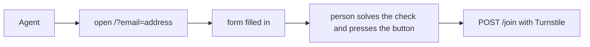

# A person presses the button

**Status:** Shipped 2026-11-14
**Tier:** 🔴 structural
**Owner approval:** the owner asked on 2026-11-14 that an agent instruct the person to open the form already filled in and click, instead of a captcha-free request, and that agent-only text with technical terms such as POST not be visible on the page
**ADRs:** [0062](../../adr/0062-an-agent-opens-the-form-already-filled-in-and-the-person-presses-the-button.md), which supersedes [0044](../../adr/0044-an-agent-requests-access-without-the-captcha-under-weighted-limits.md)
**Not changing:** the join form, Turnstile, the form's limits, the welcome email, the old `agent` rows

## Problem

`POST /api/request-access` wrote to the waitlist without Turnstile and, once the welcome email existed, sent an email to any address the caller chose. The landing page also showed the endpoint to every visitor.

## Goals

- No captcha-free write path.
- `GET /?email=<address>` opens the form with the address in the field; an agent gives that link to the person, who presses the button.
- The landing page shows nothing written for agents; the Markdown twin, `llms.txt`, the agent card and WebMCP keep the instructions.

## Non-goals

- Deleting old `agent` rows or the `source` column.

## Design

### Data flow

### Failure handling

| Failure | Outcome |
|---|---|
| The `email` parameter is not an address | the form opens empty |
| The page has no form (waitlist paused) | `fill_join_form` answers `form_not_available` |

## Open questions → answers

None.

## Test strategy summary

Integration tests for the prefill, the private cache header, the twin text and the page without an agents section; unit tests for `fill_join_form`; the landing Playwright spec for the tool and the link.
