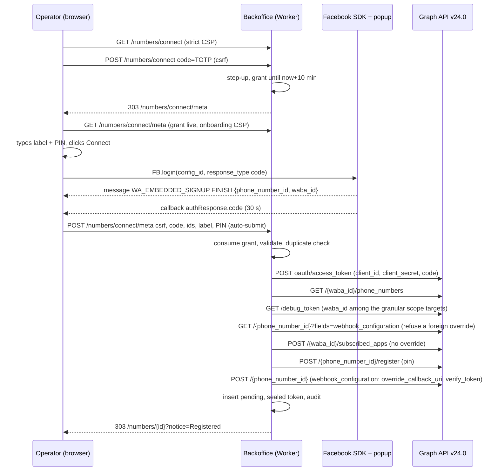

# Meta onboarding

**Status:** Building
**Tier:** 🔴 structural
**Owner approval:** approved 2026-11-11 (owner delegated)
**ADRs:** [0036](../../adr/0036-one-fixed-meta-app-and-numbers-join-through-embedded-signup.md), [0037](../../adr/0037-only-the-onboarding-page-loads-the-facebook-sdk-under-its-own-policy.md); amends [0031](../../adr/0031-the-backoffice-is-a-separate-host-signed-in-with-a-key-and-totp-enrolled-from-the-owners-terminal.md) and [0032](../../adr/0032-whatsapp-numbers-are-rows-in-a-sealed-registry-not-worker-secrets.md)
**Not changing:** number states and transitions, verify with Meta, activate, close and disable, replace access token, the sealed access token and `NUMBER_REGISTRY_KEY`, the start link, account binding and backfill, sign-in, the strict policy on every other backoffice page, `WHATSAPP_VERIFY_TOKEN`

## Problem

The backoffice "Register a number" form asks for a Meta app (an existing row, or a new app ID, label and app secret) and, per number, the phone number ID, WABA ID, display number, label and access token. The operator copies all of it from WhatsApp Manager and Business settings. zapbip has one Meta app, `714836811568009`.

On 2026-11-11 the owner ordered:

- "o meta app id, label e secret tem que ser fixo, e os dados do phone number tem que usar o onboarding da meta";
- "so eu por enquanto": only the operator onboards zapbip's own numbers;
- the Facebook Login for Business configuration ID for Embedded Signup exists. It is not secret, so it is a constant beside the app ID;
- "não faça tantos gates e verificações": a lean plan with one test pass.

## Goals

- The app ID, its label and the Embedded Signup configuration ID are constants. The app secret is the Worker secret `META_APP_SECRET`, and it verifies every webhook and authenticates the code exchange.
- `meta_apps` and `whatsapp_numbers.meta_app_ref` are gone, and the migration is safe on any data.
- The backoffice "Connect a WhatsApp number" flow takes a fresh TOTP code, then a label and a two-step PIN, then runs Meta's Embedded Signup. It stores the number as `pending` with a sealed business token. Verify and activate follow as today.
- The Facebook SDK runs on that one page only, under an explicit allowlist. Every other page keeps the strict policy.
- The code and the token never reach the browser, a log, an error or a flash.

## Non-goals

- Onboarding numbers of other businesses (Tech Provider review, Advanced Access, a customer-facing flow).
- A second Meta app, or a per-environment app.
- Re-connecting an existing number to refresh its token. "Already registered" answers, and the replace-access-token form stays.
- Payment method, display name review and template creation: the operator does those in WhatsApp Manager ([meta-setup.md](../../runbooks/meta-setup.md)).
- Automatic verification after the connect. The existing verify step stays a separate, stepped-up action.
- Rotating `META_APP_SECRET` without a redeploy. `wrangler secret put` already makes a new version.

## Design

### Data flow



1. `GET /numbers/connect` is a plain stepped-up form with the strict policy: a Confirm block with the TOTP field and Continue. `POST /numbers/connect` runs `stepUpOf` with target `number`/`connect`. When accepted, it sets `backoffice_sessions.onboarding_grant_until = now + ONBOARDING_GRANT_TTL_MS` (10 minutes) and answers `303` to `/numbers/connect/meta`. A rejected code redirects back with the existing `401` flash, and a rate-limited one answers `429`.
2. `GET /numbers/connect/meta` answers `303` to `/numbers/connect` when the session has no live grant. Otherwise it renders the onboarding page under the onboarding policy (ADR 0037). The page has a label field (1 to 60 characters), a PIN field (six digits, `inputmode="numeric"`, `autocomplete="off"`), the Connect button carrying `data-app-id`, `data-configuration-id` and `data-graph-version`, and hidden `csrf`, `signupCode`, `phoneNumberId` and `wabaId` fields.
3. `/assets/embedded-signup.js` runs `FB.init({ appId, autoLogAppEvents: false, xfbml: false, version })`. On click it checks `form.reportValidity()` and calls `FB.login` with `config_id`, `response_type: 'code'`, `override_default_response_type: true` and `extras: { setup: {} }` (v4: the configuration picks the products, and session info arrives without `sessionInfoVersion`). It keeps the IDs from a `FINISH` message (origin check of ADR 0037) and the code from the callback. When it holds both, it fills the hidden fields and calls `form.requestSubmit()`. `CANCEL`, `ERROR`, or a callback without a code shows a status line from the page's copy and submits nothing.
4. `POST /numbers/connect/meta`, after the CSRF guard:
   1. consumes the grant: `UPDATE ... SET onboarding_grant_until = NULL WHERE token_digest = ? AND onboarding_grant_until > ?`, which must change exactly one row. Otherwise it answers `303` to `/numbers/connect` with the `401` flash and `StepUpRejected`;
   2. parses the fields: the IDs digits only, the code non-empty, the label 1 to 60 characters, the PIN six digits;
   3. refuses a phone number ID that is already registered (`409`, field error duplicate) before any Graph call;
   4. runs `onboardNumber` (below);
   5. calls `registry.registerNumber` with `pending` and the sealed token;
   6. audits `number.registered`;
   7. answers `303` to the number page with `Registered` or `RegisteredWithBackfill`.

   Any failure redirects to `/numbers/connect` with a flash that holds only the status, a failure key, the field errors and, for a Meta failure, the step and kind: never the label, the PIN, the code or the IDs.
5. The webhook route attributes as today, by known phone number ID or WABA ID. It verifies with `META_APP_SECRET`, and an unattributed delivery still pays one placeholder check.

### Interfaces

- `libs/types/src/constants.ts`: `META_APP_ID = '714836811568009'`, `META_APP_LABEL = 'zapbip'`, `META_LOGIN_CONFIGURATION_ID = '946808808378298'`, `ONBOARDING_PIN_PATTERN = /^\d{6}$/`. The configuration is "Chatwoot v2" on the Logic Bit app (WhatsApp Embedded Signup, WhatsApp Cloud API and Marketing Messages API, a system-user token that never expires, WhatsApp accounts, `business_management`, `whatsapp_business_manage_events`, `whatsapp_business_management`, `whatsapp_business_messaging`). The owner may later create a dedicated "zapbip" configuration and swap the ID; the constant is the only place to change.
- `Bindings.META_APP_SECRET?: string`, set by the owner with `wrangler secret put`. It is **not** in `WorkerSecret`, because that list refuses the deploy: the Worker still serves without it, so `WarnedWorkerSecret.MetaAppSecret` makes the preflight print a typed `PreflightWarningKind.MetaAppSecretMissing` warning and never refuse. The webhook fails closed while it is unset: `verifyWebhookSignature` answers false for a missing or empty secret, so every delivery is a `401`; the backoffice connect throws `META_APP_SECRET is not set` (`500`) before any Graph call. The test bindings carry it; `.env.example` does not, because no script reads it.
- `apps/api/src/numbers/meta-onboarding.ts`:

  ```ts
  export enum OnboardingStep { Exchange = 'exchange', Inspect = 'inspect', Read = 'read', Subscribe = 'subscribe', Register = 'register', Override = 'override' }
  export class OnboardingError extends Error { readonly step: OnboardingStep; readonly kind: GraphErrorKind }
  export type OnboardedNumber = { accessToken: string; displayNumber: string; verifiedName: string | null };
  export function onboardNumber(input: {
    graphBaseUrl: string; appSecret: string; webhookUrl: string; verifyToken: string;
    code: string; phoneNumberId: string; wabaId: string; pin: string; fetcher: typeof fetch;
  }): Promise<OnboardedNumber>;
  ```

  The exchange is a form-encoded `POST /v24.0/oauth/access_token` (`client_id`, `client_secret`, `code`) without an `Authorization` header, through the same timeout as the Graph client. The exchange timeout stays armed until the body is read. The other calls use `createGraphClient` with the business token. Nothing changes at Meta before the ID checks pass: the phone number list must hold the phone number ID (`Read`, `NotFound`), `debug_token` must list `waba_id` among the targets of the `whatsapp_business_management` granular scope (`Inspect`, `NotGranted`), and the number's `webhook_configuration.phone_number` must be absent or on this environment's origin (`Read`, `WebhookClaimedElsewhere`). Then the WABA is subscribed with no override (an override at WABA level would re-point a WABA that also holds another environment's number), the number is registered, and this environment's webhook is set as an override of that number only. Graph error codes decide the kind before the status does: `133005` is `PinMismatch`; `133016`, `4`, `80007` and `130429` are `RateLimited`; `100` and `190` during the exchange are `CodeExpired`. `displayNumber` is `+` followed by `digitsOf(display_phone_number)` and must match `DISPLAY_NUMBER_PATTERN`; a phone number ID absent from the WABA list is `OnboardingError(Read, NotFound)`.
- `NumberRegistry.registerNumber(input: { phoneNumberId; wabaId; displayNumber; label; accessToken })`. `registerMetaApp`, `registerNumberWithNewMetaApp` and `openAppSecret` are removed, and so are `RegisteredNumber.metaAppRef`, `NumberAdmin.listMetaApps` and `NumberAdmin.replaceAppSecret`.
- Migration `0008_meta_onboarding.sql`. It refuses when `meta_apps` holds another app ID, through a guard table with `CHECK (foreign_apps = 0)` as its first statements. It rebuilds `whatsapp_numbers` without `meta_app_ref` under `PRAGMA defer_foreign_keys = true`, copying every row and recreating `whatsapp_numbers_waba`. It drops `meta_apps` and adds `backoffice_sessions.onboarding_grant_until INTEGER`.
- `NumberSegment.Connect = 'connect'` and a `meta` sub-segment. The `/meta-apps/*` protected path, the register form, the app-secret route and their copy keys are removed.
- `PagePolicy { Strict, EmbeddedSignup }`: a request variable that `securityHeaders` reads to choose the header record. It defaults to `Strict`.

### Failure handling

| Case | Answer | Stored |
|------|--------|--------|
| No live grant on GET or POST of `/numbers/connect/meta` | `303` to `/numbers/connect` (`401` flash on POST) | nothing |
| Invalid label or PIN, or non-digit IDs | `303`, `422` flash with field errors | nothing, grant spent |
| Phone number ID already registered | `303`, `409` flash, duplicate | nothing, no Graph call |
| Exchange, read, inspect, subscribe, register or override fails | `303`, `502` flash naming the step and the kind (`auth`, `not_found`, `network`, `upstream`, `code_expired`, `pin_mismatch`, `rate_limited`, `not_granted`, `webhook_claimed_elsewhere`); operator event `backoffice.onboarding_failed` with step and kind | nothing |
| Phone number ID not in the WABA's list | as above, step `read`, kind `not_found` | nothing |
| Race: the same number inserted between check and insert | `RegistrationConflictError` → `409` flash | nothing |
| Migration finds a foreign app | the migration fails on its guard; tables untouched | nothing changed |
| SDK fails to load, or the user cancels | status line on the page, no post | grant stays until it expires |

Subscribe and register are idempotent at Meta, so a retry after a later-step failure is safe. A retry needs a fresh code from a new `FB.login`.

### Known risks

1. **The real SDK may need a host the allowlist lacks.** The owner's first staging connect reads the console. A missing host is added by amending ADR 0037.
2. **The token expiry depends on the configuration.** The runbook says to choose "Never" when the configuration is created.
3. **The exchange `POST` form is not shown in Meta's example**, which uses `GET`. The owner's first staging connect proves it. The fallback is `GET` with the secret in the query, recorded as an ADR 0036 amendment.
4. **One secret for both environments** (ADR 0036, consequences).

## Open questions → answers

| Question | Options | Owner's answer | Date |
|----------|---------|----------------|------|
| Fixed app or rows | rows / constants | constants for ID and label, Worker secret for the secret | 2026-11-11 |
| Who onboards | operator / customers | the operator only ("so eu por enquanto") | 2026-11-11 |
| Configuration ID storage | secret / constant | a constant; the value is the owner's | 2026-11-11 |
| Existing `meta_apps` rows | drop / copy / refuse | refuse a foreign app, copy rows of the fixed app (owner delegated) | 2026-11-11 |
| PIN | typed / generated and sealed | typed by the operator, never stored (owner delegated) | 2026-11-11 |
| Step-up placement | final post / before the popup | before the popup, one 10-minute grant (owner delegated) | 2026-11-11 |
| Inline handler | nonce / hash / `'self'` asset | `'self'` asset, no inline script (owner delegated) | 2026-11-11 |
| Staging routing on one app | second app / per-WABA override / per-number override | per-number override, refused when another origin already holds the number (review of 2026-11-11) | 2026-11-11 |
| Keep the manual form | keep / remove | remove (owner's order) | 2026-11-11 |
| Depth of gates | full / lean | lean: one tester pass ("não faça tantos gates") | 2026-11-11 |

## Test strategy summary

- Integration (Workers pool) against FakeGraph: the four onboarding calls on the happy path; each step failing; the grant consumed once; no grant; a duplicate before any Graph call; the token sealed and absent from every log line and flash; the webhook verified with `META_APP_SECRET`; migration `0008` copying a fixed-app row, refusing a foreign app, and adding the grant column.
- Unit: the onboarding form parse, and the page policy record.
- E2E (Playwright, backoffice): the operator steps up, fills the label and PIN, clicks Connect. The SDK is stubbed by a route, and its frame on `https://www.facebook.com` is served by Playwright under the real policy. The number lands Pending with the fake display number, and the console shows zero errors. Also cancel and no-grant.
- One tester pass of `test-plan.md`. The owner's first staging connect with the real SDK is recorded under coverage honesty.

## Decisions made while building

- The owner supplied the configuration ID on 2026-11-11, so there is no unset sentinel and no "not configured" state.
- `META_APP_SECRET` warns in the preflight instead of refusing (see Interfaces).
- Plan step 4 was built before step 2 so the typed registration was gone before the registry lost `registerMetaApp`; `plan.md` records the order.
- The failure flash drops the label (the redirect target is the step-up page, which has no label field), a strictly smaller leak surface than the spec first stated.
- The browser script is a string module (`assets/embedded-signup.ts`) served from `GET /assets/embedded-signup.js?v=<hash>`, so no wrangler text rule for `.js` is needed.
