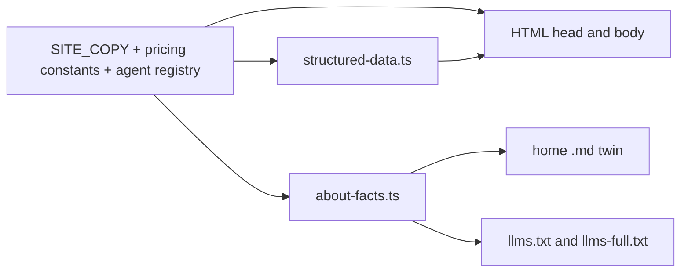

# SEO, GEO and speed of the landing page and the app

**Status:** Building
**Tier:** 🟡 medium
**Owner approval:** approved 2026-11-13 (owner delegated)
**ADRs:** [0052](../../adr/0052-structured-data-is-one-json-ld-graph-built-from-the-same-copy-and-constants-as-the-page.md)
**Not changing:** the CSP, the join route, pricing, the page copy beyond the meta descriptions and the About facts, WhatsApp copy, `libs/core`, `apps/docs`

## Problem

The owner (2026-11-13, translated): "make SEO, GEO, Open Graph, ld+json scripts impeccable" and "make the landing page and the app load impeccably fast".

## Goals

- Every indexable page in the eight languages has a unique `<title>` and meta description inside the length budget (weighted length: a full-width character counts two; title at most 70, description 50 to 160), a canonical with no query, the eight hreflang alternates plus `x-default`, `<html lang>`, one `<h1>` and headings in order. A legal page's `og:title` and `twitter:title` are its own title.
- The sitemap carries `<lastmod>` (`SITE_UPDATED_ON` for the home pages, `LEGAL_UPDATED_ON` for the legal pages).
- `og-<locale>.png` exists for every `WebLocale`, 1200 by 630, under 300 KB, rendered by `apps/api/scripts/render-open-graph-images.ts` from the page copy; `siteAssetOf` maps the Open Graph image of each language to its own file while the demo media keep the English fallback.
- Every indexable page carries one `<script type="application/ld+json">` graph: `Organization` (Logic Bit, logo, url, GitHub `sameAs`), `WebSite`, and on the home page a `WebApplication` with a free and a Pro `Offer` in the page currency and the `FAQPage` of the visible FAQ with the same text; a legal page carries a `BreadcrumbList` instead of the application and the FAQ.
- GEO: `llms.txt`, `llms-full.txt` and the home Markdown twin open with an "About zapbip" block (one-sentence definition, pricing, supported agents, limits, date) filled from the same constants as the page; a unit test compares the facts across the JSON-LD, the twin and the llms files.
- Speed: the Turnstile script loads when the person touches the form (or on a submit without a token), not on every visit; `/site/*` media get a cache header; budgets are documented below and checked by `apps/api/scripts/lighthouse-budget.ts`.

## Non-goals

Web fonts, inline critical CSS (the CSP forbids inline style), a CSS minifier, a CDN of our own, new pages.

## Design

### Data flow

### Interfaces

`structuredDataOf({ model })` returns the graph; `serializeStructuredData` escapes `<`, `>` and `&` as `<`, `>`, `&` so the data block cannot end early. `aboutFactsOf({ locale })` returns the definition and the fact lines; `SiteCopyKey.About{Title,Definition,Pricing,Agents,Limits,Updated}`. `SITE_UPDATED_ON` beside `LEGAL_UPDATED_ON`. `apps/api/site-public/_headers` sets `Cache-Control` for `/site/*`.

### Failure handling

A language without About copy is a type error. A JSON-LD block is data: `script-src` does not run it, and the CSP is unchanged (proved by `landing-seo.spec.ts`, which reads no console error).

### Speed budgets

| Metric | Budget |
|---|---|
| Lighthouse performance, mobile | at least 95 |
| LCP, Slow 4G | under 2.0 s |
| CLS | 0 |
| TBT | under 100 ms |
| Home HTML | under 60 KB uncompressed |
| Stylesheet | under 60 KB uncompressed (about 10 KB brotli) |
| Site script | under 40 KB uncompressed |
| Above the fold transfer before the video | poster under 25 KB |

Cloudflare compresses text responses with brotli at the edge; the Worker sets no `Content-Encoding`.

### Measured

Before and after Lighthouse numbers are recorded in `tester-briefing.md` once the orchestrator runs `lighthouse-budget.ts`.

## Open questions → answers

| Question | Options | Owner's answer | Date |
|----------|---------|----------------|------|
| One JSON-LD script per type or one graph | per type, one `@graph` | one `@graph` per page (delegated) | 2026-11-14 |
| Pro availability | InStock, PreOrder | PreOrder, billing is not open | 2026-11-14 |

## Test strategy summary

Unit: JSON-LD builders against the schema.org required properties, fact consistency, length budgets in eight languages, Open Graph asset map and sizes, `_headers`, sitemap `lastmod`. Integration: head tags, headings and JSON-LD per page and language. Playwright: CLS 0, LCP under 2.0 s, Turnstile and video loading behaviour, JSON-LD under the CSP.
