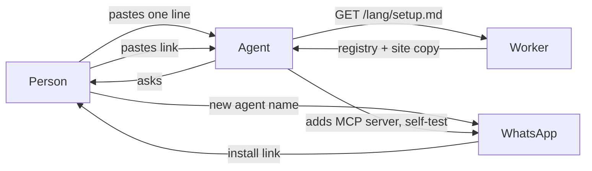

# Site logos and the one-line setup prompt

**Status:** Building
**Tier:** 🟡 medium
**Owner approval:** approved 2026-11-13 (owner delegated)
**ADRs:** [0050](../../adr/0050-an-agent-sets-itself-up-from-a-one-line-prompt-that-points-to-a-generated-setup-page.md)
**Not changing:** the join route, Turnstile, pricing, the install sections' text, the WhatsApp commands, the CSP

## Problem

The owner (2026-11-13, translated): "the examples on the homepage are missing official logos" and "why would someone make the MCP changes by hand? isn't it better to ask the AI itself, with a one-line prompt, to set itself up?"

## Goals

- Every agent whose vendor publishes its mark on its own site or repository under terms that allow naming the product shows that mark on the quick start tab. Source, terms and date are in `apps/api/site-public/site/logos/NOTICE.md`. An agent whose vendor allows no such copy keeps its initials.
- Each quick start tab shows one line to paste into that AI, in the page language, pointing at `<language path>/setup.md`. The manual command moves into a collapsed `
` named "Prefer to do it by hand?". The Copy button of the line copies the line.
- `<language path>/setup.md` is served as `text/markdown` in all eight languages from the install registry and the site copy: what zapbip is, step 1 (the human sends `new agent <name>` through the start link), step 2 (per client, the registry's command with a placeholder for the link), step 3 (the self-test text), safety.
- The setup URL is linked from `llms.txt`, the Markdown twins, the agent card and the `get_quick_start` answer, which also carries the one line.

## Non-goals

A setup page that mints a link by itself, a new WhatsApp command, a vendor mark whose owner forbids the use.

## Design

### Data flow

### Interfaces

`SitePath.Setup = '/setup.md'`; `setupPathOf({ locale })` beside `llmsPathOf`; `setupMarkdownOf({ locale, origin })`; `quickStartEntriesOf({ locale, connectionLink })`; `SiteCopyKey.Start{Prompt,PromptAny,Manual}…` and `SiteCopyKey.Setup…`; `QuickStartEntry.prompt`.

### Failure handling

A language without setup copy is a type error (`Record<WebLocale, …>`). An agent without a mark renders its initials. The page is complete with no script; the details element works without one.

## Open questions → answers

| Question | Options | Owner's answer | Date |
|----------|---------|----------------|------|
| One setup URL or one per language | neutral URL, per language | per language, the path decides (owner delegated) | 2026-11-13 |
| Codex and ChatGPT marks | initials, the OpenAI Blossom | the Blossom from openai.com, its brand terms allow naming the product (owner delegated) | 2026-11-13 |

## Test strategy summary

Unit: logo files and notice, setup copy keys. Integration: quick start prompt per tab and language, details collapsed, setup page per language, links. E2E and walk: quick start at 1440 and 375.
