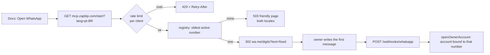

# Start link

**Status:** Building
**Tier:** 🔴 structural
**Owner approval:** owner delegated 2026-11-06
**ADRs:** [0035](../../adr/0035-a-start-link-on-the-worker-picks-the-number-new-owners-write-to.md); builds on [0016](../../adr/0016-accounts-start-on-the-first-message-and-wait-on-a-list.md), [0032](../../adr/0032-whatsapp-numbers-are-rows-in-a-sealed-registry-not-worker-secrets.md)
**Not changing:** account creation, `owner_identities`, `accounts.number_id`, the `closed` and `disabled` semantics, the webhook attribution, the backoffice, the install page route

## Problem

On 2026-11-08 the owner said: "nao teremos 1 unico numero oficial eu acredito". Numbers are already dynamic: the backoffice holds a sealed registry (`NUMBER_REGISTRY_KEY`) and webhooks are attributed by known `phone_number_id`s. The docs still assume one fixed number:

- `libs/types/src/constants.ts` holds `OFFICIAL_WHATSAPP_NUMBER = OFFICIAL_NUMBER_UNSET`;
- `apps/docs/snippets/official-number.mdx` and `apps/docs/snippets/pt-br/official-number.mdx` print `wa.me/OFFICIAL_NUMBER_UNSET`, and eleven pages import them (the home, get-started and the five agent pages, in both languages; the agent pages come from `libs/agents/supported/*/page.*.mdx`);
- `runDocsPreflight` (`apps/api/src/operations/deploy-preflight.ts`) and `deploy.ts` refuse to publish while the constant is unset;
- `apps/docs/e2e/get-started.spec.ts`, `apps/docs/e2e/from-zero.spec.ts` and `tools/repository-shape/src/docs-experience.test.ts` read the constant.

A new owner starts by writing to a zapbip number, so the docs need one stable link that always lands on a number that accepts new owners.

## Goals

- `GET https://mcp.zapbip.com/start` answers `302` to `https://wa.me/<digits>?text=<prefilled>`, the number being the oldest `active` number of the registry (ADR 0035).
- No active number: a friendly `503` page in pt-BR and en-US, never a `wa.me` link.
- The docs link to the start link, a constant derived from `PRODUCTION_PUBLIC_ORIGIN`. They print no phone number.
- `OFFICIAL_WHATSAPP_NUMBER`, `OFFICIAL_NUMBER_UNSET`, the `official-number` snippets, the docs-preflight number check and the deploy number gate are removed, with their tests and runbook steps.
- The route cannot be turned into an open redirect, enumerates nothing beyond its one target, and is rate limited.

## Non-goals

- Moving an account to another number, a per-campaign `ref`, least-loaded or capacity-aware selection, a landing page with a QR code.
- Changing what the first message does. Any text creates the account; the prefilled text is only a convenience.
- A start link for staging in the docs. Staging serves `/start` on its own host for the walk; the docs name production only.

## Design

### Data flow

1. The docs link carries `?lang=en` or `?lang=pt-BR` (the `DocsLanguage` values). The route reads only that parameter and ignores every other one.
2. The route checks the rate limit per client address (below), then asks the registry for the oldest active number.
3. The registry returns the display number (`+` and 7 to 15 digits, validated at registration). The route re-checks that pattern, strips the `+` and builds the target from a fixed origin (`https://wa.me`), the digits and the fixed text of the locale. Nothing from the request, apart from the validated `lang`, reaches the target.
4. The owner opens WhatsApp with the text prefilled and sends it. The webhook attributes the delivery to that number by `phone_number_id`, `openOwnerAccount` creates the account with `homeNumberId` set to that number, and everything after that is today's flow.

### How an account maps to its number

Read from the code before writing this spec:

- `accounts.number_id` (migration `0005_backoffice.sql`) is set at creation to the number of the first message (`openOwnerAccount({ homeNumberId })` in `apps/api/src/inbound/owner-inbound.ts`). Every outbound send resolves it through `NumberRegistry.openForAccount`.
- An owner who writes to a different number than the account's home number gets `refuseOtherNumber`: the message is dropped and the owner is told the home display number.
- A new owner on a `closed` number gets `refuseNewAccount`; `pending` and `disabled` numbers ignore inbound. So the start link must choose `active` only, and the choice must be made per request, never cached.
- Registration backfills `accounts.number_id` only when exactly one number exists. An account with no home number on a registry of two or more numbers is dropped with `inbound.account_without_number` (see Known risks).

The start link adds no column and no write. It reads one row.

### Interfaces

Constants in `libs/types/src/constants.ts` (and enums where a closed set exists):

- `START_LINK_PATH = '/start'`, `START_LINK` (`PRODUCTION_PUBLIC_ORIGIN` followed by `START_LINK_PATH`), `START_LINK_LANGUAGE_PARAMETER = 'lang'`.
- `WHATSAPP_LINK_ORIGIN = 'https://wa.me'`, `WHATSAPP_LINK_TEXT_PARAMETER = 'text'`.
- `START_PREFILLED_TEXT: Record<OwnerLocale, string>`, in the shape of `INSTALL_SELF_TEST_TEXT`: pt_BR "Oi! Quero conectar meus agentes de IA ao zapbip." and en_US "Hi! I want to connect my AI agents to zapbip." Neither is a bare-word command (ADR 0015).
- `HttpStatus.Found = 302` is added to the enum.

Port `NumberRegistry` gets `findStartDisplayNumber(): Promise<string | null>`, implemented in `d1-number-registry.ts` by `SELECT display_number FROM whatsapp_numbers WHERE state = 'active' ORDER BY created_at, id LIMIT 1`. It reads no `sealed_` column, so `backoffice-isolation.test.ts` is untouched.

Route `apps/api/src/routes/start-link.ts`, `createStartLinkRoute({ registry, limiter })` mounted in `app.ts` like the install page. Copy lives in `apps/api/src/routes/start-link-copy.ts` (pt_BR and en_US), the page is rendered by a pure function.

| Request | Answer |
|---------|--------|
| `GET` or `HEAD /start`, active number | `302`, `Location: https://wa.me/<digits>?text=<encoded fixed text>`, `Cache-Control: no-store` |
| `GET /start?lang=en` or `?lang=pt-BR` | the text of that locale; page copy of that locale first |
| `GET /start` with no `lang` | `DEFAULT_LOCALE` (pt_BR), the existing product default |
| `GET /start?lang=fr` or a repeated `lang` | `400`, plain text `bad request` |
| no active number | `503`, `Retry-After`, `text/html`, both locales, `lang` order first |
| over the rate limit | `429`, `Retry-After`, plain text `too many requests` |
| missing client address header | `400`, plain text `bad request` (same as the install page) |
| any other method or path under `/start/` | `404` |

Security headers on every answer, in the install page's style: `Cache-Control: no-store`, `X-Robots-Tag: noindex`, `Referrer-Policy: no-referrer`, `X-Content-Type-Options: nosniff`, HSTS. The HTML page also carries `Content-Security-Policy: default-src 'none'` and has no script, no style and no external resource.

Rate limit: reuse the `INSTALL_PAGE_LIMITER` binding (30 per 60 s) with the key `start:<clientRateKey(address)>`, so the counter is separate from the install page's, and no new binding, wrangler block or preflight check is added. (Alternative: a new `START_LINK_LIMITER` namespace; rejected as three wrangler blocks and an env type for the same numbers.)

Deploy and docs removal:

- `libs/types`: delete `OFFICIAL_NUMBER_UNSET` and `OFFICIAL_WHATSAPP_NUMBER`.
- `apps/api/src/operations/deploy-preflight.ts`: delete the number check and the `officialWhatsAppNumber` field of the docs and Worker preflight inputs; `scripts/docs-preflight.ts` and `scripts/deploy.ts` stop passing it.
- `apps/docs/snippets/official-number.mdx` and `pt-br/official-number.mdx` become `start-link.mdx` in both languages: one sentence and a link `START_LINK?lang=en` / `START_LINK?lang=pt-BR`, anchor text "Open WhatsApp" / "Abrir o WhatsApp". The pages keep importing a snippet, renamed; the agent pages change in `libs/agents/supported/*/page.*.mdx` and `apps/docs/agents` is regenerated.
- Runbooks: `mintlify-publish.md` step 1 and `deploy.md` (the number gate in the list of refusals and the go-live check of `OFFICIAL_NUMBER_UNSET`) lose the number; `meta-setup.md` and `backoffice.md` say that the start link follows the registry, and that closing a number sends new owners to the next active one.

### Failure handling

- Registry read fails: `500`, plain text `server error`, log event `start_link.failed` (event name only; no number in the log, per the backoffice rule). Never a redirect.
- The stored display number fails the `+` and 7 to 15 digits pattern (a hand-edited row): treated as no usable number, logged as `start_link.invalid_number`, answered with the `503` page. Never a redirect built from an unvalidated value.
- A number leaves `active` between the redirect and the first message: the owner writes to a number that is now `closed` and gets the existing closed-number notice; `disabled` ignores the message. Accepted: the window is seconds, and the next click lands on another number.
- Two active numbers created in the same millisecond: `ORDER BY created_at, id` is total, so the choice is deterministic.
- The `503` page is not cached and not indexed; the docs link keeps working the moment a number turns active.

### Known risks

- **Concentration.** All new owners land on the oldest active number until the operator closes it. Meta's per-number limits are not read by zapbip. Mitigation: the backoffice `closed` state, documented in the backoffice runbook. Revisit: least loaded (ADR 0035).
- **An existing owner clicks the link.** They may be sent to a number that is not their home number and get the "your account is on the other number" notice. Acceptable: the notice names the right number. The link cannot know who clicked.
- **A closed home number.** An owner whose home number is `closed` keeps working. If the operator `disabled`s it, that account's sends are refused and no flow moves it to another number (out of scope; revisit in ADR 0035).
- **Accounts with no home number.** If an account predates the first registered number and a second number is registered before the first backfills, that account is dropped silently with `inbound.account_without_number`. The start link does not create such accounts (every account it leads to is created with a home number); the registry's backfill is unchanged. Recorded here so the operator checks `accounts.number_id IS NULL` before registering a second number; the plan adds that check to the backoffice runbook.
- **The display number is public through the redirect.** It is the number the owner is meant to write to; the route returns one number per request, rate limited, with no list and no way to select another.

## Open questions → answers

| Question | Options | Owner's answer | Date |
|----------|---------|----------------|------|
| One official number or several | one constant; many numbers in the registry | "nao teremos 1 unico numero oficial eu acredito" | 2026-11-08 |
| How the docs reach a number | a link on the Worker; the number printed in the docs | a stable link on the Worker; the docs print no number (owner delegated) | 2026-11-06 |
| How the number is chosen | oldest active; rotation; least loaded; random | oldest active, load spread by closing a number (owner delegated; [ADR 0035](../../adr/0035-a-start-link-on-the-worker-picks-the-number-new-owners-write-to.md)) | 2026-11-06 |
| No active number | friendly page; redirect to the docs; a broken link | friendly `503` page in both locales, never a `wa.me` link (owner delegated) | 2026-11-06 |
| Locale of the prefilled text | `lang` parameter; `Accept-Language`; fixed pt-BR | `lang` parameter with the `DocsLanguage` values, absent is the default locale, unknown is `400` (owner delegated) | 2026-11-06 |
| Free `text` parameter | accept it; fixed text only | fixed text only, so the link cannot be used to write messages for a victim (owner delegated) | 2026-11-06 |
| Rate limit | new binding; reuse the install page limiter with its own key | reuse `INSTALL_PAGE_LIMITER` with the `start:` key prefix (owner delegated) | 2026-11-06 |
| Removal of the fixed number | keep as fallback; remove | remove the constants, snippets, preflight check and deploy gate (owner delegated) | 2026-11-06 |

## Test strategy summary

Unit for the pure parts (target builder, language parser, page renderer, preflight without the number). Worker integration against the real D1 for selection by state and age, each answer of the table, headers, rate limit and the open-redirect attacks. Shape tests for the docs (no `wa.me` and no phone number in `apps/docs`, the snippet links `START_LINK`) and for the removed constants. The two docs Playwright specs assert the link instead of the number. A Playwright MCP walk of the redirect and the no-number page. Details in [test-plan.md](test-plan.md).
