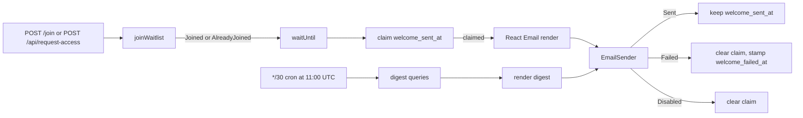

# Subscriber emails

**Status:** Shipped 2026-11-14
**Tier:** 🟡
**Owner approval:** requested by the owner on 2026-11-14 ("a daily digest of subscribers, and a welcome email to every subscriber, with React Email and Resend"); this written spec awaits his read
**ADRs:** [0058](../../adr/0058-email-is-sent-through-resend-with-react-email-templates.md)
**Not changing:** the join answers, the Turnstile and rate-limit order, the referral rules, the backoffice waitlist page

## Problem

A person who joins the waitlist hears nothing until an invitation, and the owner sees the list only in the backoffice.

## Goals

- A welcome email, once per subscriber, right after a successful join from the site form or the agent request-access route, in the subscriber's language, from `zapbip <hello@zapbip.com>` with reply-to `support@zapbip.com`.
- A daily digest at 11:00 UTC to `support@zapbip.com`, in Portuguese, even on a day with no new subscriber.
- A join never waits for, or fails because of, the email provider.
- Production deploys before `RESEND_API_KEY` exists; without it nothing is sent and the log says so.

## Non-goals

- Retrying a failed welcome on a schedule; a repeated join tries again.
- Unsubscribe links: the welcome and the digest are transactional, one each.
- Access-opened emails; invitations keep their current path.

## Design

### Data flow

### Interfaces

- `EmailSender.send(message) → EmailSendOutcome` (`Sent | Failed | Disabled`), never throws.
- `createEmailSender({ env, fetchImplementation })`: `Resend` with the key, `Fake` in development without it, `Disabled` otherwise.
- Migration `0016_welcome_emails.sql`: `landing_waitlist.welcome_sent_at` and `welcome_failed_at`, both nullable integers.
- Scheduled job `subscriber_digest`, due at `SUBSCRIBER_DIGEST_HOUR:SUBSCRIBER_DIGEST_MINUTE` UTC.

### Failure handling

| Failure | Outcome |
|---|---|
| `RESEND_API_KEY` unset | `email.disabled` log line per skipped message, no row stamped as sent |
| Resend non-2xx or unreachable | `email.send_failed` with the kind and status, `welcome_failed_at` stamped, the join already answered |
| Two joins of one address at once | The conditional claim lets one send |
| The digest send fails | The scheduled tick fails and reports it like any job |

## Open questions → answers

| Question | Options | Owner's answer | Date |
|----------|---------|----------------|------|
| Digest language | pt_BR, en_US | pt_BR, sent with a constant locale | 2026-11-14 |
| Digest time | any UTC hour | 11:00 UTC, 08:00 in Brazil | 2026-11-14 |

## Test strategy summary

Unit tests for the Resend request, the delivery choice, the templates in every language, the copy parity, the digest facts and content and the job's schedule; integration tests in workerd for the welcome after both join routes, once only and in the background, and for the digest queries against D1.
