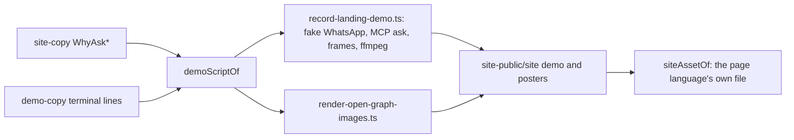

# Visual localization: every language shows its own examples and animations

**Status:** Building
**Tier:** 🟡 medium
**Owner approval:** approved 2026-11-14 (owner delegated)
**ADRs:** none; builds on [0047](../../adr/0047-the-web-surfaces-speak-eight-languages-through-a-web-locale-while-whatsapp-copy-stays-in-two.md) and removes its English media fallback
**Not changing:** the page layout, the CSP, the demo timeline, the product copy beyond what the demo reads

## Problem

The owner (2026-11-14, translated): "the examples and visual animations have to be translated too." Demo video and posters existed for English and Portuguese only, the six other languages showed the English demo through `siteAssetOf`, and the Open Graph phone bubble in those six kept English button labels.

## Goals

- Demo video (`mp4`, `webm`) and both posters exist for every `OwnerLocale`, recorded with that language's conversation: the question, the two buttons and the reply come from `site-copy*.ts` (`WhyAsk*`), the terminal lines from `apps/api/scripts/landing-demo/demo-copy.ts` (one entry per language).
- `og-<locale>.png` for every language draws the same question and buttons.
- `siteAssetOf` has no English fallback: the asset language is the page language, and `apps/api/test/unit/site-assets.test.ts` fails when any language lacks its demo, posters or Open Graph file, or when a file leaves its size budget.
- HTML and CSS mocks (hero demo steps, "Why zapbip" scenes, the app's sign-in phone) already read per-language copy; `demo-copy.test.ts` pins that the recorder reads the same words.

## Non-goals

Re-timing the animation, new scenes, docs screenshots (the docs carry no localized image of the product).

## Design

### Data flow

### Adding a language (Arabic next)

1. Add the language to `OwnerLocale` and its copy everywhere the typed records demand it (site copy, shell copy, legal, client app); `Record<OwnerLocale, …>` makes every gap a type error.
2. Add its entry to `TERMINAL_COPY` in `demo-copy.ts`; the question, buttons and reply come from its `WhyAsk*` site copy.
3. Add its owner phone to `OWNER_PHONES` in `record-landing-demo.ts`.
4. Run `pnpm exec tsx apps/api/scripts/record-landing-demo.ts --locale <code>` for the demo and `pnpm exec tsx apps/api/scripts/render-open-graph-images.ts` for the cards, one at a time. Right-to-left layout of the stage is a design task of its own: check the render before committing the media.
5. `site-assets.test.ts` and `demo-copy.test.ts` go green when the files and the terminal entry exist.

### Failure handling

A language without a terminal entry or a media file is a type error or a red test. The recorder takes `--locale` so a failed recording is repeated alone.

## Open questions → answers

| Question | Options | Owner's answer | Date |
|----------|---------|----------------|------|
| Where do the terminal lines live | site copy, recorder copy module | the recorder's own `demo-copy.ts`, because no page shows them | 2026-11-14 |

## Test strategy summary

Unit: demo script per language from the site copy, terminal lines apart from English, Open Graph data, media present, sized and named per language. Integration: the page of each language points at its own demo, poster and card.
