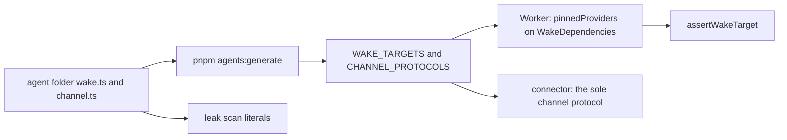

# Wake providers and channel protocol in the agent folders

**Status:** Shipped 2026-11-14
**Tier:** 🔴 structural
**Owner approval:** the owner asked on 2026-11-14 that adding, changing or removing a supported agent touch at most one or two folders, and for a leak check
**ADRs:** [0064](../../adr/0064-a-wake-provider-and-a-channel-protocol-belong-to-the-agent-folder.md), extending [0033](../../adr/0033-one-folder-per-supported-agent.md)
**Not changing:** the stored provider ids, the security rules of a pinned host, the generic webhook, the docs prose

## Problem

The pinned wake providers (hosts, path patterns, headers) lived in `libs/core`, `libs/types` and `apps/api`, and the Claude Code channel protocol lived in `libs/types` and `apps/connector`. Four packages named two agents, and the leak scan could not see it.

## Goals

- A `wake.ts` and a `channel.ts` facet in the agent folder; `libs/core`, `libs/types`, `apps/api` and `apps/connector` name no agent.
- The leak scan fails on a wake host, a provider id, a channel capability or method named outside the folder.

## Non-goals

- Generating the documentation prose that explains each agent.

## Design

### Data flow

### Failure handling

| Failure | Outcome |
|---|---|
| A stored provider id no agent declares | the transport throws, the attempt is a retry |
| Zero or two channel agents | the connector refuses at load with a message |

## Open questions → answers

None.

## Test strategy summary

Unit tests in each agent folder, the leak-scan tests, the connector protocol test, the rewritten core wake tests on neutral providers, the transport test through the registry, and the unchanged integration suites.
