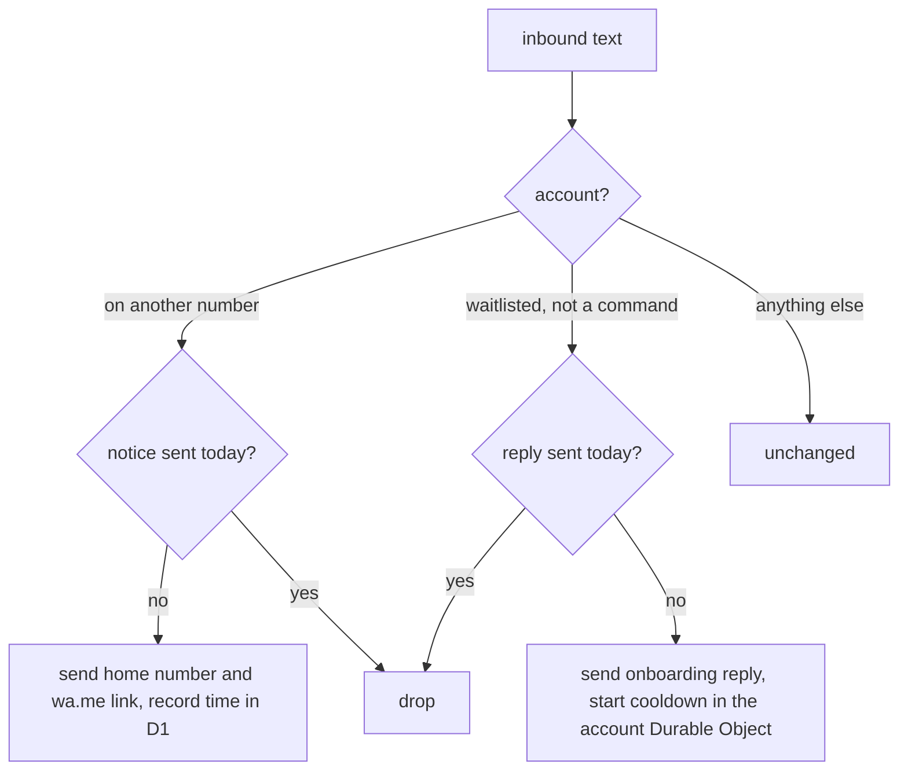

# WhatsApp onboarding replies

**Status:** Shipped 2026-11-14
**Tier:** 🟡
**Owner approval:** approved 2026-11-13 (delegated)
**ADRs:** [0049](../../adr/0049-a-phone-gets-one-onboarding-reply-a-day-and-a-customer-on-another-number-is-pointed-home.md)
**Not changing:** account creation, the waitlist flag, the access release and invite redemption, the commands, the 24-hour window rules, suspended and deleting accounts

## Problem

The owner asked what a stranger sees when they write to a zapbip number. Today a waitlisted phone gets a two-line "you are on the waitlist" reply to every message and no way forward, and a customer who writes to a number that is not the one holding their account is told the number without a link, on every message.

## What happens today, per case

| Case | Today |
|------|-------|
| New phone, number open, waitlist on | An account is created `waitlisted`; every message that is not `ajuda`/`entrar`/`apagar conta` gets "You are on the waitlist. Send help when access opens." plus the company line |
| New phone, number open, waitlist off | An account is created `active` with no agent; the first message is stored and the owner is told "No agent is connected. Your message is saved." (no setup instruction) |
| New phone, number closed | No account; "This number is not accepting new accounts right now." on every message |
| Waitlisted account on its home number | The waitlist reply to every message that is not a command |
| Active account on its home number | Routed to its agents, unchanged |
| Active or waitlisted account on another active number | No account is created, nothing is routed; "Your account is on {number}. Send your messages to that number." on every message, no link |
| Suspended account | "Your account is suspended." on every message |
| Deleting account | The deletion is finished and nothing is sent |

An account has exactly one home number, the one its owner first wrote to ([ADR 0035](../../adr/0035-a-start-link-on-the-worker-picks-the-number-new-owners-write-to.md)); this feature keeps that.

## Goals

1. A waitlisted phone gets one onboarding reply, in its language: what zapbip is, that access is by waitlist and the phone is on it, the setup link (the docs get-started page, per language) and the request-access link (the site home, per language). Later messages inside one day get no second reply; commands still work; after a day the reply comes again.
2. A customer who writes to a number that is not its home gets one reply a day with the home number and its `wa.me` link, and nothing is created or routed.
3. Every other case is unchanged.

## Non-goals

- A reply to an `active` account that has no agent (the "No agent is connected" notice stays). A new phone with the waitlist off is covered by the setup copy of a later change.
- A cooldown on the closed-number refusal.
- The other six languages (lane L4a adds them) and the future `/setup.md` link (one constant per language to change).

## Design

### Data flow

### Interfaces

- `libs/types`: `ONBOARDING_SETUP_LINKS` and `ONBOARDING_REQUEST_ACCESS_LINKS` per `OwnerLocale`.
- `libs/core` `receiveAccountMessage`: the `Waitlisted` verdict goes through the existing `approvalCooldowns` port with the key `onboarding_reply` for `ONBOARDING_REPLY_COOLDOWN_MS` (one day). The cooldown starts only after a reply was sent for a message that was not a redelivery.
- `apps/api` `receiveOwnerInbound`: `refuseOtherNumber` claims `other_number_notices` (migration `0015`, one row per account) for `OTHER_NUMBER_NOTICE_COOLDOWN_MS` (one day) and adds the `wa.me` link of the home number to the copy.

### Failure handling

- A failed send of the waitlisted reply leaves its cooldown unstarted, so the webhook retry replies. The other-number notice is claimed with one conditional upsert before the send, so two deliveries at once send one; a failed send there is not retried until the cooldown ends.
- A deleted account loses its `other_number_notices` row in the same batch as the rest of its rows; the Durable Object cooldown goes with the object.

## Open questions → answers

| Question | Options | Owner's answer | Date |
|----------|---------|----------------|------|
| One reply or one per message | each message / cooldown | Cooldown, so commands stay usable | 2026-11-13 |
| Where the cooldown lives | D1 table for both / Durable Object for the waitlisted reply and D1 for the other-number one | The place each decision is made: the waitlist decision is inside the Durable Object, the other-number one never reaches it | 2026-11-13 |

## Test strategy summary

Core unit tests for the cooldown on the waitlisted reply; an integration file through the inbound handler for a new phone, the repeat, a command, an English phone, the right number, the wrong number (once, again after the cooldown, in English, nothing created or routed) and a suspended account.
